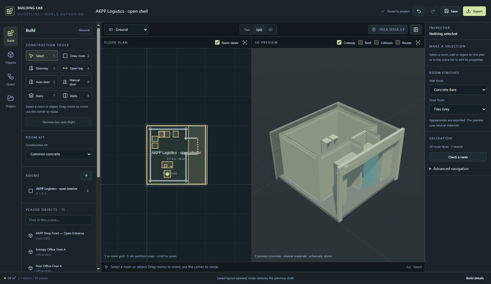
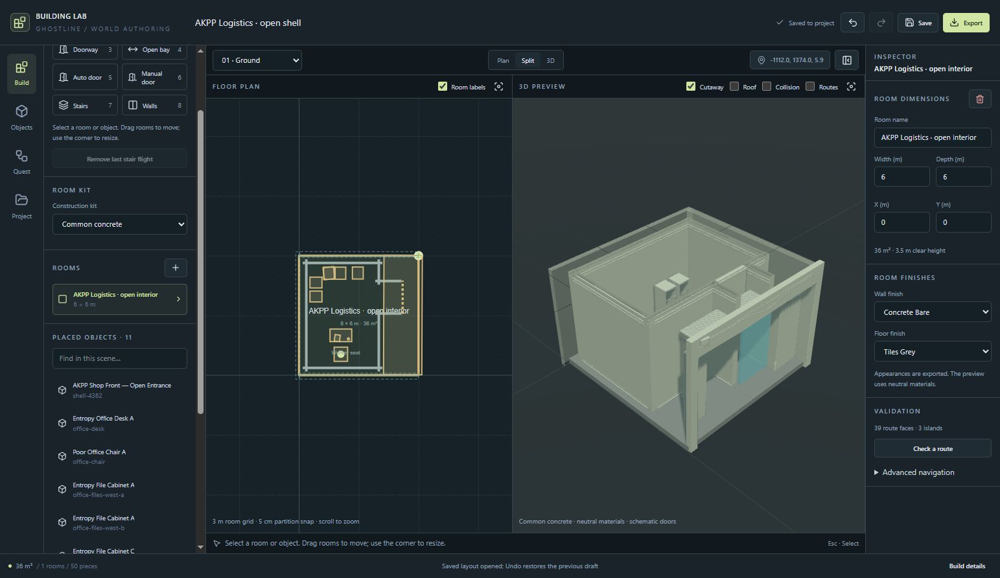
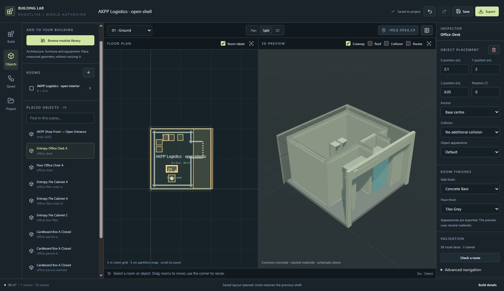
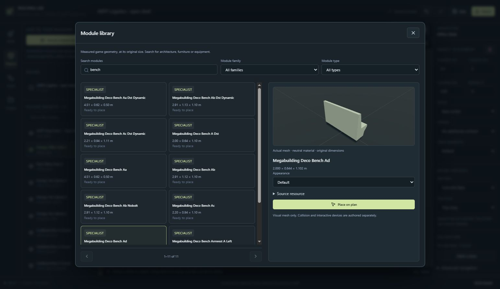
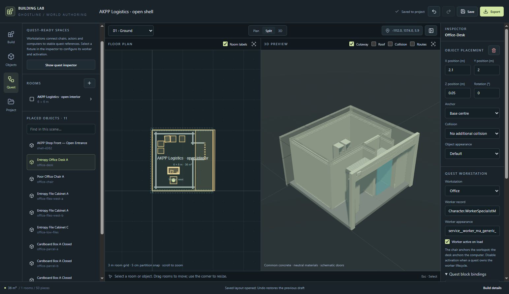
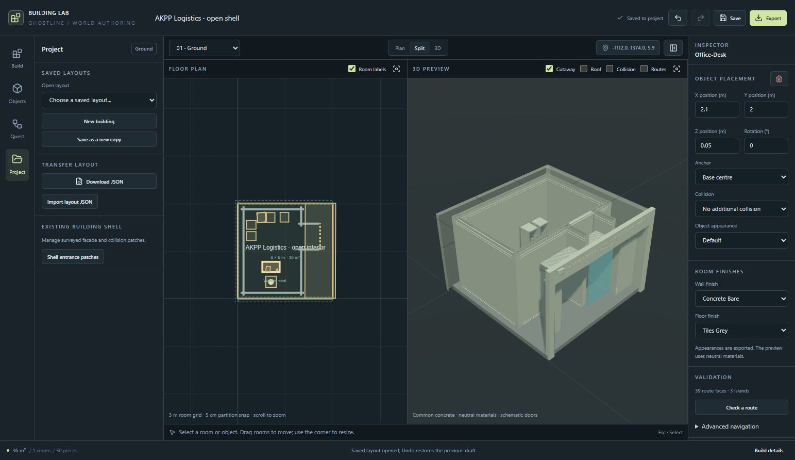
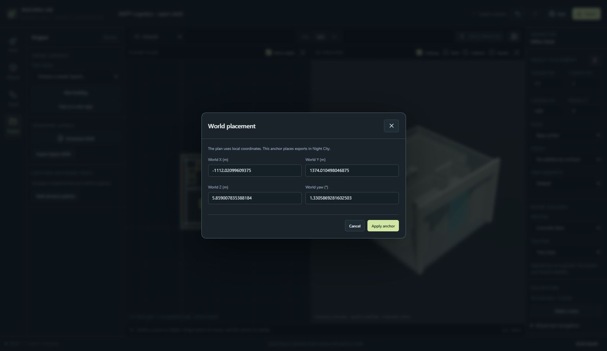
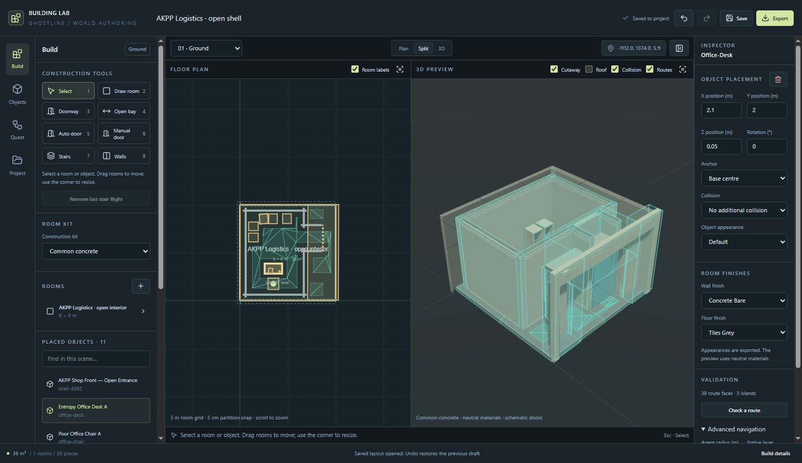
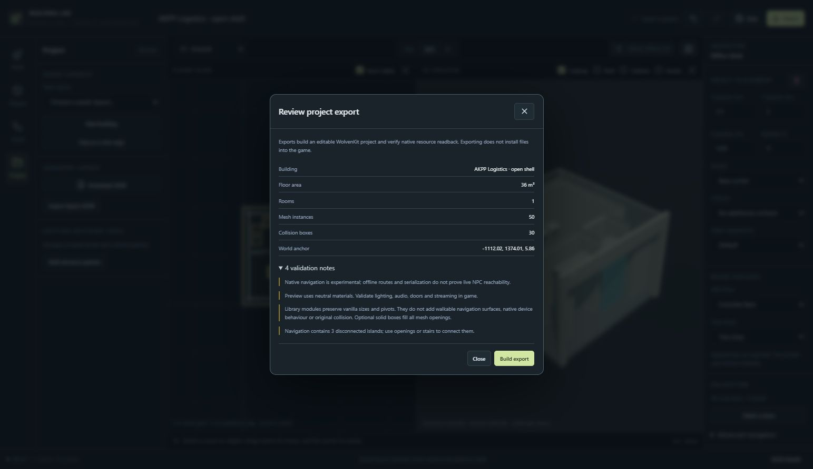

# A tour of Building Lab

From a floor plan to a furnished, quest-ready interior: a practical walkthrough of the live building editor, illustrated with nine screenshots.

Example: **AKPP Logistics · open shell**. Screenshots show the current local UI. Click any image to inspect it at full size.

## Contents

- [The plan and preview share one workspace](#the-plan-and-preview-share-one-workspace)
- [Draw, select and size rooms](#draw-select-and-size-rooms)
- [The object inspector gives precise control](#the-object-inspector-gives-precise-control)
- [Search measured modules before placing them](#search-measured-modules-before-placing-them)
- [Workstations expose stable references](#workstations-expose-stable-references)
- [Open, copy and transfer layouts](#open-copy-and-transfer-layouts)
- [Local plan coordinates become world placement](#local-plan-coordinates-become-world-placement)
- [Inspect geometry, collision and connectivity](#inspect-geometry-collision-and-connectivity)
- [Export has a separate review step](#export-has-a-separate-review-step)
- [A typical working pass](#a-typical-working-pass)

*01 / Find your bearings*

## The plan and preview share one workspace

Use the left rail to switch between **Build**, **Objects**, **Quest** and **Project**. The centre holds the floor plan and 3D preview; the inspector on the right shows settings for the current selection.

### Top bar

Name the building, undo or redo edits, save the layout and review an export.

### Workspace bar

Choose the active floor, switch Plan / Split / 3D, or open the world coordinate anchor.

### Preview controls

Use Cutaway, Roof, Collision and Routes to inspect different aspects of the compiled building.

*The AKPP layout in Split view. The preview uses neutral materials; it is a geometry inspection view.*

*02 / Build the space*

## Draw, select and size rooms

Choose a **Construction kit**, then use **Draw room** on the plan. Select a room from the plan or room list to reveal its dimensions and position. Drag to move it, use its highlighted corner to resize, or enter exact values in the inspector.

Rooms use a 3 m grid. The tool palette also provides Doorway, Open bay, Auto door, Manual door, Stairs and Walls. Use the floor selector when working across storeys.

*This example is a 6 × 6 m room with 36 m² of floor area. Room edits and precise placement belong in the selection inspector.*

Fields commit on Enter or when you leave the field. Escape cancels an uncommitted field edit. Use Undo if a committed geometry change needs reversing.

*03 / Position individual pieces*

## The object inspector gives precise control

Select a placed object to edit its X, Y and Z position, rotation, anchor and appearance. The object list is useful when pieces overlap or are hard to select in the plan.

**Base centre** and **Original mesh pivot** provide different placement anchors. The collision selector is separate from appearance: a visible mesh does not automatically supply the collision or device behaviour of its vanilla location.

*The office desk is selected. Its placement is X 2.1 m, Y 2 m, Z 0.05 m, with a base-centre anchor.*

*04 / Find vanilla assets*

## Search measured modules before placing them

Open **Objects → Browse module library**. Search by name and narrow results with the family and type filters. Select a result to inspect the actual geometry, original dimensions and available appearances, then choose **Place on plan** when ready.

*A search for “bench”, with Megabuilding Deco Bench Ad selected. It measures approximately 2.00 × 0.64 × 1.10 m and offers Default and Pink appearances.*

Library placement preserves the module's vanilla size. Visual modules need separately authored collision, navigation or interactive devices where those behaviours are required.

*05 / Connect the space to a quest*

## Workstations expose stable references

The **Quest** panel connects workstation chairs, actors and computers to quest references. Open the quest inspector to choose a workstation and review its worker record, appearance and activation setting.

**Quest block bindings** reveals the community, entry, phase, workspot, computer and completion fact references. **Copy bindings** makes these available to quest authoring. When a quest controls the worker's lifecycle, disable automatic activation as appropriate for that quest.

*The AKPP Office workstation and its expanded bindings. This is a configured example; browsing the panel does not create a new workstation.*

*06 / Manage authoring files*

## Open, copy and transfer layouts

The **Project** panel contains saved layouts, **New building** and **Save as a new copy**. Use **Download JSON** and **Import layout JSON** to transfer the authoring layout. **Shell entrance patches** opens controls for surveyed facade and collision patches.

*Save in the top bar writes the current authoring layout. Save as a new copy is available when creating a separate variant.*

*07 / Place it in Night City*

## Local plan coordinates become world placement

Click the coordinate button above the workspace to open **World placement**. X, Y and Z define the world anchor; yaw rotates the exported building around that anchor. Review the values and use **Apply anchor** to commit, or Cancel to leave them alone.

*The AKPP example's existing anchor. Coordinates shown here are specific to this layout.*

*08 / Check the result*

## Inspect geometry, collision and connectivity

Enable **Collision** and **Routes** above the 3D preview. The inspector reports route faces and disconnected islands; **Check a route** supports a more focused connectivity check. Advanced navigation exposes agent radius, native layer and the experimental native navigation option.

*This example reports 39 route faces and 3 islands. Overlays help diagnose the layout; offline connectivity does not establish live NPC reachability.*

Use an in-game test to check stair and wall joins, flickering surfaces, player collision, NPC movement, door behaviour, lighting, audio and streaming at the intended location.

*09 / Review before building*

## Export has a separate review step

Click **Export** to review the building summary, mesh and collision counts, world anchor and validation notes. **Build export** creates the editable WolvenKit project and verifies native resource readback. Exporting does not install files into the game.

*The review screen was opened for this walkthrough; no export or game installation was performed.*

*Keep beside the editor*

## A typical working pass

1. Open a saved layout, or create a new building and choose its construction kit.
2. Draw and size rooms, then add openings, doors, walls and stairs.
3. Browse vanilla modules and place the furniture or equipment.
4. Refine positions, pivots and appearances in the inspector.
5. Configure workstation bindings where the quest needs them.
6. Check the world anchor, preview overlays and validation notes.
7. Save, review the export, then build and playtest through the project workflow.

**Handy keys:** `1` Select · `2` Draw room · `3` Doorway · `4` Open bay · `5` Auto door · `6` Manual door · `7` Stairs · `8` Walls · `Ctrl+Z` Undo · `Ctrl+Shift+Z` Redo · `Ctrl+S` Save.

Continue with the [editor reference](building-editor.md), [kit library](building-kits.md), [workstation guide](building-workstations.md) or [navigation guide](building-navigation.md).

Captured from the local Building Lab UI on 27 October 2026. The existing AKPP layout was used for illustration; no layout edits were saved and no game files were installed. Screenshots are stored alongside the guide under docs/images/building-ui-walkthrough.
