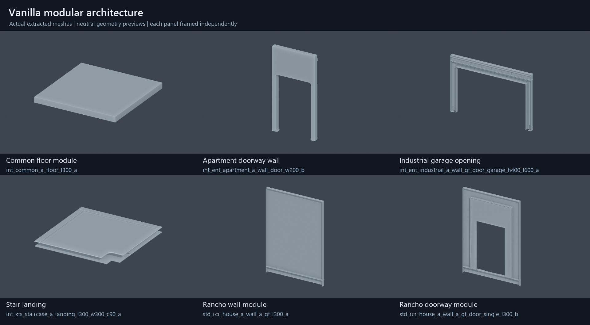

# Buildings and interiors

Ghostline can compose new buildings and add rooms inside existing shells using
vanilla architecture. The missing capability is an integrated authoring layer
that keeps architecture, collision, openings, lighting, streaming and gameplay
placement together. NPC navigation needs its own proof: creating a walkable
floor for V does not create navigation for an NPC.

This investigation covers the local Night City sector corpus, fresh reads from
the installed base-game archives, the local modding documentation, WolvenKit's
readers, ArchiveXL's implementation and the installed World Builder. Research
date: 25 October 2026. It produced no installed world edit.

## What the vanilla data establishes

The scan covered **16,256 serialized Night City sectors**, totaling
30,402,589,921 bytes, and found **10,153 distinct architecture resource paths**.
These are paths referenced by this corpus, not a count of all assets in the
game or a certification that every referenced resource exists. The corpus is
under `base/worlds/03_night_city`; it is not an exhaustive Dogtown survey.

Thirteen sectors received structural inspection, including collision buffers
and embedded navigation. Eleven resources were freshly serialized from
`K:/Cyberpunk 2077/archive/pc/content`: eight architecture meshes, a native
door entity and two sectors. Six meshes were exported and rendered as geometry
previews. Their apertures are actual mesh geometry, not inferred from names.



The previews use neutral shading and independent framing. They establish
geometry, not in-game materials, scale comparison between panels or collision.
One apartment-doorway material-sidecar export reported a missing default
material dependency; all six geometry exports succeeded.

The compact evidence is
[`reference/world/building-interiors-research.json`](../../reference/world/building-interiors-research.json).
The reproducible inspector is
[`tools/audit_building_interiors.py`](../../tools/audit_building_interiors.py).
Its full local output, including per-node references and all 10,153 paths, is
`generated/building-interiors/evidence.json`.

## A building consists of several independent layers

| Layer | Vanilla representation | Consequence for authoring |
| --- | --- | --- |
| Visible architecture | `worldStaticMeshNode`, `worldInstancedMeshNode`, destructible mesh nodes | Compose walls, floors, ceilings, stairs and trim. Preserve appearances and actual instance transforms. |
| Physical surfaces | `worldCollisionNode` actor and shape tables; some physical entity components | Author floors, wall barriers and openings separately from visible meshes. |
| Interactive entrances | Door/shutter entities, often `worldDeviceNode`, with instance data | An opening mesh supplies geometry; a native door supplies behavior and its own collision. |
| Visibility | Static/instanced occluders, mesh occluder settings, proxy meshes | Audit what hides the new room and what appears at distance. |
| Streaming | Sector descriptors inside `.streamingblock`; per-instance distances | The building and its required collision must load before the player reaches them. |
| Interior behavior | `worldInteriorAreaNode`, or `worldTriggerAreaNode` with interior notifiers | Choose interior classification and gameplay restrictions explicitly. |
| Lighting | Lights, reflection probes, light-channel volumes, GI nodes | A roof and an interior notifier do not reproduce a finished vanilla lighting setup. |
| Sound | Ambient areas, emitters, generated acoustic resources; occasional acoustic portals | Add room tone and indoor/outdoor transitions independently. |
| Navigation | `worldNavigationNode` plus embedded `worldNavigationTileResource` | Survey existing Human coverage; new levels may need new native navigation data. |
| Population and interactions | Communities, AISpots, workspots, devices and quest references | Keep world geometry separate from actor lifecycle and quest activation. |
| Maps and guidance | Interior map/minimap data, entrance markers, journal mappins | A usable room does not automatically gain an interior map or correct GPS route. |

The local [sector format guide](../../modding_docs/for-mod-creators-theory/files-and-what-they-do/file-formats/the-whole-world-.streamingsector/README.md)
explains that CDPR's compilation splits locations across sectors and LODs.
The data confirms this separation: an `Exterior` sector can contain an interior
area, interior map nodes, room lighting and furniture. Sector category is not
proof of whether a location contains playable rooms.

Conversely, an `Interior` sector is not a self-contained building prefab.
`interior_3_-29_-1_1` has sixty node definitions and no collision nodes; this
does not establish that the location lacks collision, only that this sector
does not supply it.

## Reusable architecture kits

The following counts are distinct paths referenced by the scanned corpus.
They include subfolders such as destruction assets. They are discovery counts,
not complete-kit guarantees or counts of interchangeable modules.

All `int_*` families below are beneath
`base\environment\architecture\common\int\`.

| Family | Referenced paths | Useful starting point |
| --- | ---: | --- |
| `int_ent_apartment_a` | 123 | Apartment floors, ceilings, bathroom pieces and door walls. |
| `int_nkt_jp_apartment_a` | 329 | A large apartment family with wall, window, ceiling and floor variants. |
| `int_kts_apartment_a` | 134 | Another coherent apartment and bathroom family. |
| `int_common_a` | 213 | General floors, ceilings, walls and trim. |
| `int_ent_industrial_a` | 441 | Industrial walls, floors, structural pieces and garage entrances. |
| `int_ent_office_a` | 67 | Office floors, ceilings and other structural modules. |
| `int_mlt_office_a` | 77 | Office modules, including destruction variants. |
| `int_kts_corridor_b_motel` | 93 | Motel corridors and their supporting pieces. |
| `int_kts_staircase_a` | 54 | Landings, stairs, handrails and related modules. |
| `int_nkt_staircase_a` | 12 | A smaller staircase family. |

Exterior families are organized by district and function. Rancho's
`base\environment\architecture\santo_domingo\rancho_coronado\`
contains `std_rcr_house_a_*` walls, real and fake windows, doorway walls,
roofing, ceilings, balconies, gutters and trim. The broader directory has 141
referenced paths in this corpus. `common\garage`, `common\catwalk`,
`common\tech_shell` and district industrial families are also useful.

Start with a coherent family rather than mixing every visually attractive
module. Different families have different wall heights, openings, thicknesses,
trim and pivot conventions. Material appearances can provide variety without
changing the geometry.

### Verified mesh dimensions and pivots

These bounding-box dimensions came from fresh archive reads. Values are RED
coordinate units, approximately meters in the current authoring workflow.
They describe the entire mesh, not the clear opening within a door wall.

| Mesh basename | X × Y × Z |
| --- | --- |
| `int_common_a_floor_l300_a.mesh` | 3.005 × 3.005 × 0.200 |
| `int_nkt_jp_apartment_a_floor_a_l200.mesh` | 2.000 × 2.000 × 0.100 |
| `int_ent_industrial_a_floor_metal_l300_w100_a.mesh` | 3.000 × 1.000 × 0.201 |
| `int_ent_apartment_a_wall_door_w200_b.mesh` | 2.000 × 0.250 × 3.800 |
| `int_ent_industrial_a_wall_gf_door_garage_h400_l600_a.mesh` | 6.020 × 0.265 × 4.000 |
| `int_kts_staircase_a_landing_l300_w300_c90_a.mesh` | 3.000 × 3.000 × 0.206 |

The common floor is not centered on its origin: its bounds run approximately
from `(-3.0025,-3.0025,-0.2)` to `(0.0025,0.0025,0)`. The apartment door wall
runs from X = -2 to 0, with its base near Z = 0. Author sockets and snapping
from real local bounds and observed joins, not an assumption that every asset
is centered.

Names are hints. `std_rcr_house_a_wall_siding_gf_door_left_l50_a` is a small
trim piece, approximately 0.504 × 0.042 × 0.666 units; it is not a full doorway.
The rendered Rancho pair instead uses
`std_rcr_house_a_wall_a_gf_l300_a` and
`std_rcr_house_a_wall_a_gf_door_single_l300_b`.

None of the eight freshly inspected meshes contains `meshMeshParamPhysics`.
Several contain `meshMeshParamOccluderData`, which is visibility data, not
physics collision. This agrees with the
[node reference](../../modding_docs/for-mod-creators-theory/references-lists-and-overviews/reference-world-sectors/reference-.streamingsector-node-types.md):
static mesh placement does not supply collision.

## Recovering a vanilla assembly correctly

Preserve three different indices:

1. The definition index in `nodes`.
2. The placed-instance index in `nodeData.Data`, whose `NodeIndex` references
   that definition.
3. Any sub-instance, collision actor or actor-local shape index.

In `interior_-24_-16_1_1`, **222 definitions have 226 nodeData instances**.
Collision definition 184 is placed by nodeData index 188 and has seven actors.
ArchiveXL's `expectedNodes` checks 226, and a mutation/deletion index addressing
this placement is 188. Using 222 and 184 would address the wrong contract.
ArchiveXL's `PatchSector` implementation confirms that it obtains a node setup
first and then resolves the setup's definition index.

Instanced nodes require a further step. In `exterior_6_-32_0_0`, definition
649 is the Rancho doorway wall mentioned above. Its nodeData instance 709
is at `(0,0,0)`. Its `worldTransformsBuffer` selects **two** transforms starting
at offset 56, placing copies at approximately:

```text
(389.8580, -2032.5615, -0.7025)
(394.0340, -2034.0659, -0.7025)
```

Rotations differ too. The parent position is not the position of either wall.
Transform buffers can be shared by handles; preserve `startIndex`,
`numElements`, quaternion and scale. Destructible instances use a different
buffer layout. Existing
[`expand_blender_transform_buffers`](../../tools/world_location_world.py)
decodes both supported layouts for Blender staging and resolves shared owners.

`sourcePrefabHash` is useful for tracing authored grouping, but does not make
the compiled sector self-contained. A prefab's collision, visuals, lighting and
quest additions can be split. Use the hash as a discovery signal, then verify
the full spatial neighborhood and dependencies.

The [Blender prefab workflow](../../modding_docs/modding-guides/world-editing/object-spawner/features-and-guides/creating-prefabs-with-blender.md)
supports importing sectors, selecting a coherent assembly and exporting a World
Builder group. Its documentation explicitly notes incomplete node-type support.
Audit the export for missing collision, areas, lights, sound and gameplay refs.

## Composing a new building

A practical first building is a small single-storey room or garage on reviewed
ground. It exercises the whole pipeline without making new upper-floor
navigation the first dependency.

1. Choose a site and a family. Survey ground, existing Human navigation,
   surroundings, streaming sectors, quest content and approach sightlines.
2. Lay out a floor, doorway, walls and ceiling with explicit local transforms.
   Keep foundations and terrain intersections separate from room surfaces.
3. Add collision for the floor, walls and lintels. Leave a genuine opening;
   a single collision box covering the entire door wall will seal it again.
4. Add a native door if the room needs one. Measure its clear opening and
   travel, configure instance data and NodeRefs, and test the closed/open path.
5. Add interior and ambient areas, a suitable reflection probe and lights.
   Place those volumes within the room rather than copying a donor's old
   world-space coverage.
6. Export spatially grouped sectors and a streaming block under the owning
   project's `mod\...` paths. Register the block through ArchiveXL.
7. Prove entry, walking, exit, streaming and save/load before dressing the room
   or adding quest actors.

The [World Builder export guide](../../modding_docs/modding-guides/world-editing/object-spawner/exporting-from-object-spawner.md)
maps saved root groups to sectors. Sector bounds and individual object ranges
both matter: a sector unloading takes its objects with it regardless of their
individual ranges. Split remote rooms or far-apart builds into separate root
groups. Keep collision and required room surfaces available together.

For several floors, stairs and native lifts are separate design choices.
The [elevator guide](../../modding_docs/modding-guides/world-editing/devices/custom-elevators.md)
covers a lift, floor terminals and destination markers; the
[lift-door guide](../../modding_docs/modding-guides/world-editing/devices/custom-elevator-doors.md)
covers linked doors and persistent-state settings. A lift mesh alone provides
none of that wiring. NPC use still needs its own traversal proof.

## Retrofitting an existing shell

Classify the shell before choosing the intervention:

| Existing structure | Suitable approach |
| --- | --- |
| Already has rooms, but access is closed | Inspect the door, instance state, quest ownership and blocking collision before adding architecture. |
| Modular facade with an empty volume behind it | Replace a selected wall instance with a matching doorway module; add the interior behind it. |
| Large monolithic visual shell | Replace that local placement with a mod-owned edited mesh, or rebuild the affected facade from modules. |
| Primarily a distant proxy | Find the near-detail structure first; replacing only the proxy does not establish a playable building. |
| Unsuitable internal volume or navigation | Consider a separate interior reached by a controlled transition; that needs a separate entrance, loading and actor-lifecycle design. |

A native visual mutation can substitute a mesh resource and appearance, but
does not cut a hole in geometry. If the wall and opening are part of one mesh,
the replacement geometry must contain the hole. Editing a commonly shared
vanilla mesh in place would affect other uses; use a mod-owned replacement and
target only the intended world placement.

Opening the entrance is a coordinated change:

- Remove or replace the selected visible wall/panel instance.
- Remove only the blocking collision actors or shapes. Restore any floor or
  neighboring wall surface lost with a composite collider.
- Inspect static and instanced occluders for planes crossing the new opening
  or filling the formerly inaccessible volume.
- Check building/generic proxies and their near/far transition behavior.
- Remove fake window/interior effects where the new room is meant to be seen.
- Add the new room, lighting, audio, interior classification and gameplay.

Rancho's observed `*_window_fake_*` modules and the documented
`window_parallax_interior` material family are reasons to inspect window
construction carefully. A visible room effect behind glass is not evidence of
real geometry or a traversable space.

### Collision removal can be surgical

ArchiveXL 1.27.0 added actor-shape deletion, and that version is present in the
local game's ArchiveXL log. Its parser accepts `expectedActors` with
`actorDeletions`: a scalar selects an actor; a two-element sequence selects
`[actorIndex, actorLocalShapeIndex]`. It also supports `expectedInstances` and
`instanceDeletions` for supported instanced mesh nodes. The world patch's outer
index still addresses nodeData placement.

For a multi-shape actor, the inspected implementation disables the selected
shape through its collision preset. Selecting the only shape of an actor can
disable the actor as a whole. Shape indices are local to that actor; do not
substitute an index from the sector-wide shape table. The engine collision
buffer and ArchiveXL implementation are the authority for these distinctions.

Keep sector path, nodeData index, definition index/type, expected instance or
actor count, source prefab hash, shape identity and source hashes together in
the retrofit manifest. Count and type guards help detect incompatible updates;
they do not establish semantic identity if a patch reorders equal-count data.

The existing
[`find_collision_instances.py`](../../tools/find_collision_instances.py)
can fingerprint actors in **parsed** WolvenKit collision JSON. Native sector
JSON may instead preserve collision as opaque `Bytes`; use WolvenKit conversion
or the new audit helper's bounded raw decoding before interpreting an empty
actor lookup. Do not infer that an opaque buffer has no collision.

### Reusing collision elsewhere needs more than a hash

The [geometry-cache collision guide](../../modding_docs/modding-guides/world-editing/object-spawner/features-and-guides/geometry-cache-meshes-for-streaming-sector-collision-nodes.md)
identifies the donor `sectorHash`, actor-shape `Hash`, and `ShapeType`. Retain
those identities and the actor/shape transforms and scales. A mesh asset name
does not uniquely identify its separate cooked collider.

Current local docs say shipped sectors using collision meshes require
[UnlimitedGeometryCacheStreaming](https://github.com/notaspirit/UnlimitedGeometryCacheStreaming),
which makes geometry-cache entries accessible outside their original region.
That plugin is absent from the inspected game's plugin directory. The installed
World Builder collision class exposes primitive Box/Capsule/Sphere shapes and
does not contain the documented PhysX mesh fields. Those newer features require
a compatible tool update; they are not already available in this installation.

For a first rectilinear room, primitive floors and wall boxes avoid that
geometry-cache relocation dependency. The
[embedded collision guide](../../modding_docs/modding-guides/world-editing/miscellaneous/enable-embedded-collisions.md)
is another route for eligible physical entities, but requires actual embedded
physics in the chosen mesh. The eight examined architecture meshes do not
satisfy that prerequisite.

## Interior classification, lighting and sound

In `exterior_7_-32_0_0`, the `{sq023_gloria_up_interior}` node combines an
interior notifier with `setTier2: true`, a vehicle-forbidden notifier and a
prevention-clear notifier. This is a useful structural example, but its SQ023
identity makes it quest-linked content rather than an unowned donor location.

The installed World Builder describes Tier 2 as disabling weapons, vehicle
calls, radio and consumables. Copying that notifier into a combat interior
would therefore be a behavioral change. `treatAsInterior`, `setTier2` and
`gameRestrictionIDs` are distinct properties. Select them deliberately.

The [area-outline guide](../../modding_docs/modding-guides/world-editing/object-spawner/features-and-guides/setting-area-outlines.md)
explains how to build and link outlines. These define gameplay and audio
volumes; they do not create walls or navigation. The current
[`generate_world.py`](../../tools/generate_world.py) already supports an
interior notifier on a general trigger.

Vanilla room presentation also uses `worldAmbientAreaNode`, room-tone events,
ambient parameters, reflection probes, light channels and GI-related nodes.
For example, the Kabuki study includes ambient areas with
`amb_int_roomtone_house_poor_metal_01_with_rattles` and
`amb_g_weather_rain_on_metal_roof_01_stereo`.

A reflection probe references baked probe data; placing one does not bake a
new lighting solution for an arbitrary room. Reuse a suitable donor as an
approximation, then tune its volume, contribution, priority, blending and
lights in game. Likewise, relocating generated acoustic or GI resources is
not established merely by relocating their node.

Test windows, entrance transitions, local shadows, reflections and rain at
different times and weather. The docs state that hidden meshes stop casting
shadows, so auto-hide distances can produce apparent light leaks even when
nearby geometry is correct. Interiors intended for combat also need checks for
prevention behavior, weapon availability and entering/leaving restrictions.

## Navigation survey and subsequent prototype

**2026-10-26 update:** Building Lab now has an experimental VAND version 8 writer,
clearance-aware room/stair surfaces, device and entrance off-mesh links, native
resource export and an adapted Detour oracle. The oracle passes stairs, unlocked
and locked doors, rotated multi-tile geometry, and a custom-to-unmodified-vanilla
tile connection. These are offline results. Game loading, live device behaviour
and actual NPC movement are not established by them. See
[Building navigation](building-navigation.md) and the
[editor guide](building-editor.md). The findings below describe the initial survey
boundary that led to this work.


The full corpus contains 17,253 serialized occurrences of
`worldNavigationNode`. A fresh read of `navigation_1_-7_0_3.streamingsector`
contains four embedded navigation resources: two Human and two Vehicle.

The first Human resource,
`base\worlds\03_night_city\sectors\_generated\navigation\resources\navigation_2_-11_0.navmesh`,
has 25 tile buffers, 10,545 vertices and 14,782 triangle faces. Its converted
world-coordinate bounds span X = 324–486, Y = -1782–-1620 and Z ≈ 9.1–24.7.
Its metadata contains 37 off-mesh connection records. The second Human resource
also decoded successfully, as did both Vehicle resources.

This establishes that existing coverage can be inspected offline. Ghostline
already has the decoder:
[`world_location_nav.py`](../../tools/world_location_nav.py). It validates buffer
sizes, vertex indices, adjacency, variants and Human/Vehicle selection. It
can reconstruct geometric islands and sample positions. Such islands are
offline geometric evidence, not proof of live AI reachability or off-mesh-link
activation.

The serialized vertices use X/Z/Y component order; convert through
`vand_position_to_world`. In the inspected resource the converted vertices
already occupy the world region associated with its node. Do not blindly add
the node translation again. Establish the coordinate convention per resource
before transplanting it.

WolvenKit's `TilesReader`, `TilesBufferHeader` and sector-preview branch read
and display this data. The inspected writer dispatch has no `TilesBuffer`
rebuild branch comparable to its collision and world-transform writers.
Successful preservation of a raw navigation buffer is therefore not evidence
that changing its parsed preview fields produces a new tile.

The buffers begin with `VAND` and a second 32-bit field of 8. Upstream
[Detour's header](https://github.com/recastnavigation/recastnavigation/blob/main/Detour/Include/DetourNavMesh.h)
uses the same magic but declares tile version 7; its default polygon layout
also differs from WolvenKit's three-index face reader. Generic Recast output
is a research input, not a drop-in Cyberpunk `.navmesh` exporter.

No complete custom-navmesh baking and integration workflow was established in
the searched local docs or installed World Builder. This is a bounded missing
capability, not proof that new navigation is impossible. The next navigation
experiment would need to establish the native tile writer, coordinates, tile
identities, agent settings, adjacency, off-mesh data, variant bindings and
engine registration before asserting that NPCs can traverse new surfaces.

For near-term quest interiors:

- Prefer existing Human coverage and verify the exact floor height and
  entrance connectivity. Being above a street navmesh is insufficient.
- Place new walls/furniture so they do not silently invalidate the donor
  routes; test approaches and obstruction behavior with real NPCs.
- A stationary workspot/scene actor can be a deliberate limited design, but
  does not establish free movement, pursuit, combat or correct exit behavior.
- Require a separate navigation milestone for new upper floors, extensive
  stairs or relocated rooms that need mobile actors.

## Streaming, proxies and occlusion

The corpus contains 5,387 `worldBuildingProxyMeshNode`, 199,598
`worldGenericProxyMeshNode`, 14,791 `worldStaticOccluderMeshNode` and 9,436
`worldInstancedOccluderNode` serialized occurrences. These counts explain why
editing only the near wall is an incomplete retrofit survey.

`worldPrefabProxyMeshNode` defines `nearAutoHideDistance` and
`nbNodesUnderProxy`. ArchiveXL exposes `nbNodesUnderProxyDiff` mutations, but
changing a proxy's child-count relationship should be based on the actual
compiled layout, not an assumed independent mesh replacement.

Inspect the room from outside, inside and through the doorway, then approach
from increasing distances. Texture/mesh popping tied to the camera or a
vanishing room can indicate occlusion; a facade reappearing at distance can
indicate another proxy/LOD. Check shadows along with visibility.

The old [occlusion-removal page](../../modding_docs/modding-guides/world-editing/archived-guides/removing-occlusion.md)
is explicitly archived. Its newer guidance points to RedHotTools detection
and VolumetricSelection2077 rather than indiscriminate sector-wide removal.
Remove the occluders that obstruct the new sightline and preserve useful
occlusion elsewhere.

Use ArchiveXL `streaming: blocks:` for new world content and targeted
`streaming: sectors:` patches for reviewed vanilla placements. Follow
[project ownership](../reference/project-layout.md) and
[packaging](../workflows/build-and-package.md): authored CR2W-JSON belongs in
the owning project's `source/raw`, binaries in `source/archive`, and `.xl`
registration in `source/resources`. The repository root is not a WolvenKit
project. World Builder's editing JSON is an authoring input, not a packed
streaming sector.

## World Builder suitability for construction

World Builder can assemble the required world nodes, but its construction
workflow still leaves substantial manual work. For Ghostline's building system,
use a dedicated layout authoring layer and treat World Builder as an optional
in-engine inspection, dressing and adjustment tool. Requiring every room to be
built through its object controls would preserve much of the friction the new
system is meant to remove.

This assessment compares the installed tool, upstream source at
`d9680f4d7caaaf001c214e4614cc6d68cceeb0d3` and Akiway's fork at
`de6fa54b6a892df142f014963c287e1cfc1a544e`, fetched on 25 October 2026. It uses
source inspection and the local documentation's UI images, rather than a timed
hands-on build. The fork has meaningful improvements that are absent from the
installed original-style editor.

### Where the construction friction comes from

| Construction task | Inspected behavior | Implication |
| --- | --- | --- |
| Find compatible architecture | Asset/path search, previews, favorites and user-authored prefabs; the fork also improves browsing/filtering. | The author still has to identify a coherent kit, matching dimensions and suitable appearances. |
| Join wall and floor pieces | Transform fields, relative offsets, gizmos, duplication and groups. | Exact placement is possible, but kit joins and floor levels remain the author's responsibility. |
| Snap repeated modules | Surface placement and drop-to-floor exist; the fork adds rotation snapping. No general translation-grid or architectural socket snapping was found in the inspected edit paths. | Surface snapping does not align a wall endpoint with a compatible neighbor. |
| Make a doorway walkable | Original automatic colliders fit a primitive around the mesh bounds; the fork offers cached mesh-collider lookup. | A generated box seals a doorway; a suitable mesh collider or several deliberate wall solids are needed. |
| Widen an existing room | Edit the individual objects or move a selected group. No room-perimeter model or dependent wall/floor regeneration was found. | A layout change requires maintaining the component assembly and its colliders. |
| Retrofit vanilla geometry | Original viewport selection is limited to WB-spawned objects. The fork has RHT cloning/replacement and Removal Editor integration. | The newer bridge improves targeting but does not automatically coordinate facade, collision, occlusion and proxy changes. |
| Validate a finished build | Editing preview followed by native export/import and runtime checks. | Device connections and some other behavior still need verification in the native result. |

The original numeric transform implementation has both world-position and
relative-position fields. Its `posSteps` and `rotSteps` are passed to ImGui as
drag speeds with `NoRoundToFormat`; they do not implement a placement grid.
Relative offsets make an exact three-unit duplicate possible, including along
the object's axes. That is useful precision editing, but still requires the
author to know the module's pivot, usable length, orientation and intended join.
See upstream
[positionable.lua](https://github.com/justarandomguyintheinternet/CP77_entSpawner/blob/d9680f4d7caaaf001c214e4614cc6d68cceeb0d3/modules/classes/editor/positionable.lua).

The distinction matters with the verified common floor: its bounds lie mostly
on negative X/Y relative to its origin, and its full width is 3.005 units while
the nominal module is three units. Neither snapping by the full bounding box
nor placing every origin at the cursor establishes a correct modular join.
An architecture-aware tool needs reviewed connection points and nominal spans.

The original
[generateCollider implementation](https://github.com/justarandomguyintheinternet/CP77_entSpawner/blob/d9680f4d7caaaf001c214e4614cc6d68cceeb0d3/modules/classes/spawn/mesh/mesh.lua)
computes the bounding-box center and dimensions, creates one primitive collider
and groups it with the mesh. It does not inspect doorway topology. A rectangular
door wall therefore receives a solid barrier across the aperture when Box is
selected. Grouping helps keep the pair together but does not fix its shape.

### What the current Akiway fork improves

The fork's
[editor implementation](https://github.com/Akiway/CP77_entSpawner/blob/de6fa54b6a892df142f014963c287e1cfc1a544e/resources/bin/x64/plugins/cyber_engine_tweaks/mods/entSpawner/modules/utils/editor/editor.lua)
adds rotation-ring handling and configurable Shift-held angle snapping. Its
translation path still applies a mouse-derived position delta without a general
translation-grid quantization step. Specialized bend-handle snapping and other
specialized snapping features should not be mistaken for a global building grid.

The fork's
[mesh implementation](https://github.com/Akiway/CP77_entSpawner/blob/de6fa54b6a892df142f014963c287e1cfc1a544e/resources/bin/x64/plugins/cyber_engine_tweaks/mods/entSpawner/modules/classes/spawn/mesh/mesh.lua)
can look up collision-shape hashes associated with a mesh and then choose a
geometry-cache sector for the shape. It generates a sibling mesh collider using
those identities. Lookup is backed by static mapping data and can return no
matching shapes; it is not arbitrary new collision-mesh cooking. This makes
existing mapped assets more practical, subject to the collision-cache dependency
and coverage checks described above.

The fork's
[RHT bridge](https://github.com/Akiway/CP77_entSpawner/blob/de6fa54b6a892df142f014963c287e1cfc1a544e/resources/bin/x64/plugins/cyber_engine_tweaks/mods/entSpawner/modules/utils/interop/rhtPlugin.lua)
provides clone/replace actions, optional hiding of the original instance,
Removal Editor integration and copying an ArchiveXL node mutation. It also
handles additional node settings and area outlines. This is a substantial
improvement for existing-world work. Replacing the visual node still does not
identify every separate collider or occluder that belongs to the desired opening.

### Consequence for Ghostline

World Builder remains useful for choosing appearances, inspecting assets in the
engine, furnishing a prepared room, tuning lights and making final placement
adjustments. A curated set of complete prefabs would also reduce repeated work.
Those are good supporting roles.

The primary building workflow should instead store rooms, wall runs, floor
levels, openings and kit connections as authored objects. From those it should
generate visual modules, correctly split collision, door placements and room
volumes together. Changing a room dimension should update those dependents;
dropping in a prefab should not be the only reusable operation.

That authoring interface could be a focused external editor, a Blender add-on,
or an in-game tool. Its compiler should preserve native sector/ArchiveXL output
and may provide a World Builder interchange path. Making World Builder a
mandatory intermediate step would need an explicit benefit, such as useful
in-engine edits we can reliably round-trip into the authored layout.

## What Ghostline should add next

The current world generator handles quest markers, triggers, devices,
communities and references. It is not a general building compiler: the public
spec does not yet provide architecture instances, collision solids, room audio,
reflection probes or a shell-mutation manifest. Native serializers and existing
World Builder exports provide lower-level routes, but do not supply the missing
building design contract.

A useful building authoring model would contain:

| Record | Required information |
| --- | --- |
| Kit piece | Depot path, reviewed appearance, local bounds/pivot, connection sockets, dimensions and collision strategy. |
| Module instance | Stable authored ID, transform, room/floor ownership and streaming group. |
| Opening | Clear aperture, surrounding wall geometry, native door/device, collider gap and approach clearance. |
| Room | Floor/ceiling surfaces, interior and ambient outlines, lights/probes, actor positions and required navigation capability. |
| Retrofit target | Exact sector/placement/definition identity, sub-instance or collision identity, source hashes, expected counts and replacement plan. |
| Evidence | Offline geometry/collision results, package hash, named save/scenario and observed traversal/streaming behavior. |

Start with two small proofs:

1. **New room:** a single-storey modular building on reviewed existing ground,
   primitive collision, one native entrance, interior/audio volumes and lights.
   Demonstrate walking entry and exit, distance streaming and save/load inside.
2. **Shell retrofit:** one reviewed modular facade, a matching doorway
   replacement, precise collider/occluder changes and a small room behind it.
   Demonstrate that neighboring walls, exterior appearance and distant proxies
   remain correct. Add a mobile NPC only after the navigation survey passes.

These should become isolated project-owned experiments, then reusable kit and
compiler features once their runtime contracts work. The SQ023 house is a
structural study, not the default retrofit site.

## Verification and reproduction

The research helper is read-only with respect to its inputs. It writes the
requested report and optional compact snapshot; it does not pack or install.

```powershell
py -B tools/audit_building_interiors.py --scan-corpus `
  --snapshot reference/world/building-interiors-research.json

# Reinspect cases without repeating the 30 GB lexical scan.
py -B tools/audit_building_interiors.py `
  --reuse-corpus generated/building-interiors/evidence.json

# Inspect another sector stem from the same corpus.
py -B tools/audit_building_interiors.py --case exterior_6_-32_0_0 `
  --output generated/building-interiors/rancho.json
```

The scan counts serialized type/value occurrences rather than runtime objects.
It does not expand instanced meshes to compute an object count. Cached corpus
hashes identify the inspected JSON files; they are not original archive hashes.
Reusing a corpus scan retains its original source provenance.

To recreate the fresh-resource batch from the checked snapshot, create its job
manifest with ordinary Python from the repository root:

```python
import json
from pathlib import Path

snapshot = json.loads(Path("reference/world/building-interiors-research.json").read_bytes())
out = Path("generated/building-interiors/archive-readback")
out.mkdir(parents=True, exist_ok=True)
jobs = [{"resource": item["resource"],
         "output": str((out / (item["resource"].split("\\")[-1] + ".json")).resolve())}
        for item in snapshot["archive_resource_samples"]]
(out / "jobs.json").write_text(json.dumps({"jobs": jobs}, indent=2), encoding="utf-8")
```

Then run the native reader, substituting the current game path and a current
generated schema if the workstation differs:

```powershell
.\tools\ghostline-red\target\release\ghostline-red.exe cr2w-serialize-batch `
  generated/building-interiors/archive-readback/jobs.json `
  --schema red-schema.json `
  --archives-root 'K:/Cyberpunk 2077/archive/pc/content' `
  --report generated/building-interiors/archive-readback/report.json --threads 4

py -B tools/audit_building_interiors.py `
  --reuse-corpus generated/building-interiors/evidence.json `
  --resource-jobs generated/building-interiors/archive-readback/jobs.json `
  --snapshot reference/world/building-interiors-research.json
```

Validation completed for this investigation:

- All thirteen selected cached sectors inspected; all eleven fresh archive
  reads succeeded.
- The fresh `interior_-24_-16_1_1` RootChunk matches the cached one after
  ignoring serializer-generated nodeData `Id` values. Counts, resource bindings
  and all remaining RootChunk data match.
- The audit's raw collision reader agrees with a WolvenKit 8.17.4 conversion
  for all seven collision definitions in `interior_21_-27_0_1`: actor counts,
  shape-type counts, sampled actor positions and sampled actor shape types.
- All hundred embedded tile buffers in the navigation case decode with the
  existing validated navigation helper. Its eight regression tests pass.
- Six geometry exports and neutral Blender renders succeeded; the one material
  warning is recorded beside the geometry evidence above.

This establishes an offline authoring route and identifies the integration
work. Runtime claims still require a named package and save-state test:
entrance/exit, floor and wall collision, door states, camera occlusion,
distance streaming, save/load inside, lighting/weather/audio transitions and,
where applicable, NPC movement and combat.

## Sources and version boundaries

The local reference revisions were:

```text
modding_docs: a54b08735a560bca7dd76b1e1dab1631e6aaae89
WolvenKit:   4d1716b1755dcadead2815b3ec356fa61f30861c
ghostline-red: 318df312166fe18a4f1e9a89847fdb6d74638977
```

Relevant local implementation sources:

- `WolvenKit.RED4/Archive/IO/CollisionReader.cs` and `CollisionWriter.cs`;
  `Archive/IO/TilesReader.cs` and `Archive/Buffer/TilesStruct.cs` under the
  WolvenKit submodule.
- `WolvenKit.RED4/Types/Classes/worldInteriorAreaNotifier.cs`,
  `worldNavigationTileResource.cs`, `worldNavigationTileData.cs` and
  `worldPrefabProxyMeshNode.cs`.
- `WolvenKit.App/ViewModels/Documents/RDTMeshViewModel.cs`, navigation preview.
- The retained ArchiveXL source under
  `.tmp/archive-xl-src/src/App/Extensions/WorldStreaming/{Config,Extension}.cpp`.
  This is local reference material, not a Ghostline runtime dependency.
- Installed World Builder's `triggerArea.lua`, `reflectionProbe.lua`,
  `collision/collider.lua` and export UI under the configured game's CET mods.

Upstream cross-checks:

- [World Builder](https://github.com/justarandomguyintheinternet/CP77_entSpawner)
  describes native world-node additions and exporting saved groups as sectors.
- [ArchiveXL releases](https://github.com/psiberx/cp2077-archive-xl/releases/)
  records actor-shape deletion in 1.27.0.
- [ArchiveXL world-streaming implementation](https://github.com/psiberx/cp2077-archive-xl/tree/master/src/App/Extensions/WorldStreaming)
  is the source for patch addressing and mutation/deletion syntax; check the
  version actually deployed before using newer fields.
- [UnlimitedGeometryCacheStreaming](https://github.com/notaspirit/UnlimitedGeometryCacheStreaming)
  documents the geometry-cache accessibility change.
- [Recast and Detour](https://github.com/recastnavigation/recastnavigation)
  provides the upstream comparison for navigation generation and tile format;
  it does not establish Cyberpunk integration.

Several local world-editing guides are explicitly archived, including the old
manual add-location workflow, manual sector replacement and broad occlusion
removal. Their data-model explanations remain useful, but the active World
Builder export and ArchiveXL patch workflows take precedence.
