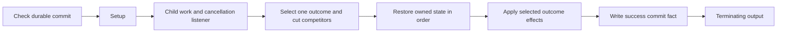

# Owned lifecycle blocks

The first implementation of the [quest research reduction plan](../reference/vanilla-quests/deep-dives/ghostline-block-roadmap.md)
is available through the existing quest manifest, registry, compiler and catalog.
These are experimental authoring implementations. They have graph tests and
an isolated serialization preview; they have no installed acceptance evidence.
Existing stage builders and story routes keep their existing behavior.

Verification on 2026-10-27: all eleven main preview artifacts and three native
variant artifacts passed CR2W conversion and typed WolvenKit readback, with
source/output hashes recorded in their generated preview reports. The variants
exercise the game clock and native specific-vehicle availability predicate.
The offline suite passed 1,051 tests; the final focused checks also cover the
additional preview publication tests. Ruff and the locked dependency check
pass. These results do not establish runtime acceptance.

## Shared lifetime

`OwnedScope` in `tools/quest_scope.py` provides one start input, named terminal
outcomes, owned listeners, permanent cut retirement, ordered restoration and
outcome effects. `owned_scope` exposes it to manifests around a bound child
phase. A successful route is:



The commit guard skips setup/effects on a completed re-entry. It represents
successful completion only; cancellation never writes it. No implicit
namespace, actor, scene exit, restoration target or reward record is invented.
Facts belong to the supplied quest namespace and must be declared in contracts
when consumed across stages. `contract.scene_entries` now complements the
existing `scene_exits`, fact and external-event declarations.

Cancellation already set on entry skips setup and child work, then restores.
Cancellation while work runs selects a terminal route. Once a route is selected,
its cancellation listener is retired; cancellation during restoration does not
abandon restoration. A bound restoration child must acknowledge its declared
terminating exit before the next operation, success effects or final commit.
An arbitrary fact in the middle of restoration is not a completion fence.

Competing routes each have a one-shot gate and permanent cut controller. A
winner cuts the other gates/controllers and owned listeners before effects.
The structural model assumes native cut propagation fences queued signals.
Simultaneous signals and cuts, permanent-cut persistence and phase reactivation
must be verified in game before promoting a binding set. No priority between
simultaneous success/cancellation signals is promised.

## Available recipes

| Stage | Bindings and behavior |
| --- | --- |
| `owned_scope` | `child` phase/entry/exits, optional notification aliases, `setup`, `restore`, outcome `effects`, optional `commit_fact` and `cancellation_fact`. Notification facts do not terminate the scope. |
| `acquire_or_use` | Snapshot item/quantity; record existing vs newly acquired inventory; both paths enter the separately bound `application` child. Possession does not establish use. |
| `access_routes` | Start independent bound attempts, retire losing attempts, converge once into the shared `application`. Each attempt exposes exactly one success port; internal rejection/retry stays inside that attempt. |
| `investigate_reactions` | Distinct Finished scans with durable `scan_fact` and post-reaction `completion_fact`. Reactions run independently; at least `required_count` completed reactions join. Optional direct-discovery fact bypasses investigation. Pins and pending reactions retire on completion/bypass/cancel. |
| `resolve_and_report` | Explicit community/entry targets and killed/unconscious/defeated policy; all target resolutions join before the report child. Resolution and successful reporting write separate facts. No reward is granted. |
| `observe_lethal` | Independent killed-only observation, once per target, continuing until `stop_fact`. Unconscious/defeated do not count as killed. Run alongside the encounter/report route with a deliberately chosen observer lifetime. |
| `reward_commit` | Wait for reporting, accept already-present item quantity or grant the specified quantity, verify inventory, restore, then commit. A mandatory durable commit prevents regrant after consumption/sale. |
| `contact_fallback` | Check caller-supplied unavailable facts; otherwise call a scene with explicit connected/rejected/etc exits. Unavailability and fallback exits converge to one journal message. Connected/fallback/cancelled are separate outcomes. |
| `adaptive_timer` | Explicit real/game clock, positive weighted duration choices, ordered fact-selected profiles and optional eligibility gate. An optional busy fact defers readiness until release or a bounded real-time timeout. Cancellation retires all waits. |
| `entitlement_reconcile` | Snapshot native `vehicle_record` availability or an upstream `entitled_fact` adapter. Record ownership and silently retire an old offer using inactive objective/message/mappin states and facts. Emit owned/unowned; no payment, purchase or delivery. |

`contact_fallback` and reconciliation do not use a success commit guard: their
public outcomes have distinct meanings. Contact once-only behavior applies to
one activation; use a quest-owned durable routing guard to prevent repeated
whole-stage activation when required. Reconciliation is deliberately repeatable
and uses exact state-setting operations. Reward repair is a separate migration
decision; a committed reward is never automatically repaired/regranted.

Reward inventory satisfaction is appropriate for a specific quest entitlement
or unique reward item. It is not an additive cash-payment primitive: already
owning the quantity satisfies the block. The example uses money only as a
serialization placeholder. Bind a suitable quest reward before gameplay use.

## Authoring and checking

[The example manifest](../../quests/examples/owned-lifecycle-blocks.quest.json)
contains every new stage and explicit placeholder bindings. Its sequential
ordering is a catalog of configurations, not a playable quest walkthrough.
In particular, an independent lethal observer should normally be composed in
a parallel branch whose stop fact comes from the main route.

All owned recipes accept exactly one input alias, `start`. Terminal outcome
aliases must match the recipe/child exits exactly, and every outcome needs a
root `on` route. `cancelled` belongs to the scope when a cancellation fact is
configured. Effects may only address declared terminal outcomes.

`setup` and `restore` are ordered action lists. Supported actions are exact
facts, inventory grants, journal objective/message state, mappin state,
community activation/deactivation, source-specific weather reset, explicit
prefab variant state and an acknowledged child phase. Restoration cannot
grant items. Setup that touches a bound presentation/actor resource needs a
matching shared restore operation. Use common inactive/released restoration
and outcome-specific success/failure effects where journal states differ.
The concurrent-owner check includes these actual bound resources and clue pins.

Restoration sets an explicit known target state; it does not capture unknown
original world state. The child owns establishment of any weather source.
Scene actor readiness, proximity/interruption behavior, busy/mute predicates
and entitlement fact adapters remain explicit dependencies. Contact delivery
means journal activation, not that the player read the message.

Resource audit inspects every nested phase and scene binding. It verifies the
named phase input and output kind, including `NonTerminating` notifications;
scene entries must point to `scnStartNode`, exits to `scnEndNode`. Missing raw
interface evidence is an error for ready stages and a warning for planned
stages. Generated sibling stages can provide interface evidence in memory.
Merely finding a packed file or matching a string does not establish a port.

```powershell
python tools/build_lifecycle_preview.py --deserialize
python tools/build_lifecycle_preview.py --spec quests/examples/owned-lifecycle-variants.quest.json --out-root generated/lifecycle-variants-preview --deserialize
python -m unittest discover -s tests -p test_quest_mechanisms.py -v
```

The preview writes only beneath `generated/lifecycle-blocks-preview`, requires
typed conversion/readback parity when requested, and records hashes plus
unresolved resource diagnostics in `preview-report.json`. It never installs or
registers the placeholder resources. The catalog lists these planned examples;
its `record-build` command deliberately refuses planned stages. Record that
catalog evidence only after a concrete binding manifest becomes ready.
The new nested validation uses the core `jsonschema`
dependency declared in `pyproject.toml`.

## Runtime promotion handoff

Before adopting a block into a shipping story, follow [quest production](../workflows/quest-production.md)
and the [playtest handoff contract](../workflows/runtime-testing.md#playtest-handoff-contract).
First bind a small independent test project and prove acceptance → interaction
→ return → verified reward → journal completion using provisional presentation.
Review its walkthrough and all dialogue/message choices before VO work.

The current library preview has no installed package/profile, install receipt
or suitable pre-registration save. It is not that early playable milestone.
Do not install its placeholder graph as a substitute. For the first bound
candidate, record the exact profile, artifact/install hashes, game/mod versions,
save identity, restart requirement, actions and observed results below.

| Scenario | Expected observation | Current evidence |
| --- | --- | --- |
| Ordinary full route and repeated completion | Application/report required; reward and journal complete once | Emitted graph tests; in-game pending |
| Existing item vs acquire later | Distinct acquisition milestones; both require use | Emitted graph tests; in-game pending |
| Alternative attempts, including simultaneous success | One application; losing attempt retired before effects | Emitted graph model; native scheduling pending |
| Both scan/reaction orders and duplicate scans | Completion waits for distinct reaction finishes | Emitted graph permutations; in-game pending |
| Direct discovery and partial investigation save/load | Bypass retires listeners; completed facts resume correctly | Graph/model reconstruction; engine save/load pending |
| Resolve unconscious, then kill before observer stop | Resolved/report/killed milestones remain independent | Emitted graph tests; actor/streaming behavior pending |
| Muted, busy, reject, connect, duplicate notifications | One appropriate message or connection outcome per activation | Emitted graph tests; actual phone/scene behavior pending |
| Every timer profile/weighted choice; time skip/load | Selected wait obeys clock; busy release or bound; cancel retires | Graph tests; skip/load and statistical/runtime checks pending |
| Cancel before entry, during work and during each restore step | No abandoned restoration or late competing commit | Graph model; native races/save interruptions pending |
| Sell/consume reward, reload completed state | No repeat grant; repair requires deliberate migration | Graph/model reconstruction; engine save/load pending |
| Vehicle entitled/unowned and stale offer re-entry | Silent retirement only when entitled; no payment/delivery | Adapter graph tests and native typed readback; runtime pending |

The donor boundaries and remaining uncertainties are preserved in the
[research roadmap](../reference/vanilla-quests/deep-dives/ghostline-block-roadmap.md).
The independent test interpreter deliberately does not execute REDengine,
scene scripts, streaming, checkpoints or saves. Passing it cannot promote
those pending rows.
