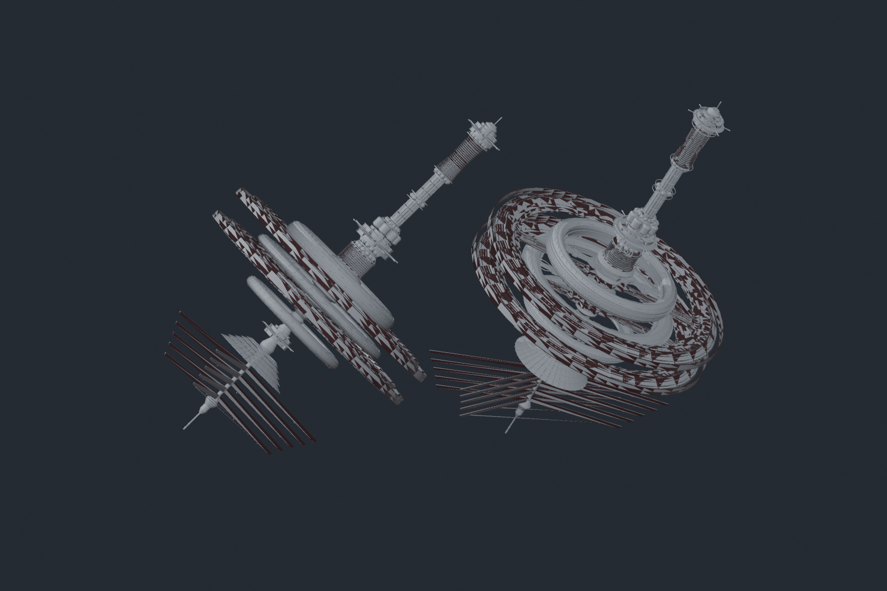

# Vanilla Crystal Palace assets

Investigated 26 October 2026 against the configured installation at
`K:/Cyberpunk 2077`. **There is a substantial, reusable orbital-station exterior
in the Q203 space ending. No playable Crystal Palace interior was established.**
This is a promising source of exterior geometry for a custom location, rather
than an existing casino level waiting to be unlocked.



This is a Blender geometry-only reconstruction from exported vanilla meshes and
serialized placement transforms. It combines the discovered placements, including
cinematic alternatives; it is not an in-game screenshot or a recreation of their
visibility timing. Materials, alpha treatment and animated ring timing are not
reproduced. Close-range surface quality remains unverified.

## What exists

The exterior pieces are fourteen meshes, `orbital_station_a_a.mesh` through
`orbital_station_a_n.mesh`, under:

```text
base\environment\decoration\misc\various\orbital_station\
```

All fourteen were freshly serialized and exported successfully. This is real
mesh geometry, including a long central spine and multiple ring structures.
Selected local bounding-box dimensions, in RED coordinate units:

| Mesh | X × Y × Z |
| --- | --- |
| `orbital_station_a_a` | 61.62 × 61.28 × 1880.57 |
| `orbital_station_a_i` | 589.11 × 588.91 × 72.95 |
| `orbital_station_a_j` | 1025.01 × 1023.88 × 44.68 |
| `orbital_station_a_m` | 1094.78 × 1094.78 × 56.96 |

These are unscaled asset bounds. The ending places the main spine at approximately
0.07955 scale: its placed length is about 149.6 units. Other pieces have different,
sometimes nonuniform scales. Preserve the assembly's individual transforms;
dropping every mesh at a common origin will not reconstruct it.

Sixty-six orbital-mesh placements were found across these depot sectors:

```text
base\worlds\03_night_city\_compiled\default\exterior_7_0_3_3.streamingsector
base\worlds\03_night_city\_compiled\default\exterior_1_0_0_6.streamingsector
```

Their origins lie roughly around X=3982–4129, Y=328–418, Z=1614–1733.
The Q203 shuttle marker is around `(4001.93, 685.21, 1590.24)`, placing these
assemblies a few hundred units from the shuttle set.

The freshly read `q203_06_cosmos.scene` explicitly toggles `station_var_a` and
`station_var_b` on `#q203_loc_prefab_space_shuttle`. This ties the station
arrangements to the Q203 ending rather than relying on a generic asset name.
Nine rotating mesh definitions occur in the main station sector, with full
rotation periods between 50 and 500 seconds.

There are also separate presentation assets:

- `q203_hologram_crystal_palace.ent`, using the three
  `crystal_palace_holo_{core,ring_a,ring_b}.mesh` resources in
  `base\environment\quests\loc_q203_vs_penthouse`. Their bounds are approximately
  one unit or less; these are tabletop hologram components.
- `base\fx\quest\q203\q203_cristal_palace.particle`: billboard emitters using
  moon/flare textures. This is separate from the substantial mesh assembly.
- Crystal Palace advertisements, leaflet resources and information scenes.

## Retrofit implications

None of the fourteen exterior meshes contains `meshMeshParamPhysics`.
The main station sector has 43 node definitions and 68 placements: static and
rotating meshes, two reflection probes, and one collision node. Its collision
node has seven actors and extents approximately `(4.09, 3.93, 7.94)`, which does
not establish collision throughout the station. It has no navigation or interior
area nodes. The second, coarser sector also contains unrelated terrain/world
nodes; its collision count cannot be attributed wholesale to the station.

Building Builder can provide a separately authored playable interior: docking
vestibule, casino floor, lounge, service corridors and mission rooms. Keep that
interior fixed in ordinary world gravity, and use the station mesh assembly as
the exterior and window vista. Rotating exterior rings do not establish rotating
walkable decks or a supported gravity system.

The first useful prototype would be one fixed docking module and a windowed room
with the station outside. Validate close-range mesh quality, scale, collision,
streaming, interior classification, lighting and NPC navigation there before
expanding. A full-size station or interiors following the curved rings would
require additional geometry and layout work beyond rectangular room composition.
Use a quest-owned copy of the assembly with reviewed transforms and visibility,
so its lifecycle is independent of the vanilla ending's variant switches.

## Evidence and limits

Compact measurements, fresh serialized-sector hashes and all 66 placement
transforms are in
[`reference/world/crystal-palace-investigation.json`](../../reference/world/crystal-palace-investigation.json).
Fresh raw JSON, batch job manifests/reports, fourteen GLBs, the reconstruction
script and its `.blend` are retained in ignored
`generated/crystal-palace-investigation`.

Discovery searched the existing 16,256-sector Night City JSON corpus and resolved
vanilla content-archive names. Target resources were then read freshly from the
content archives. This was not an exhaustive inspection of every unnamed archive
resource or expansion sector. No game files were changed, and collision,
walkability, materials and runtime streaming were not playtested.
