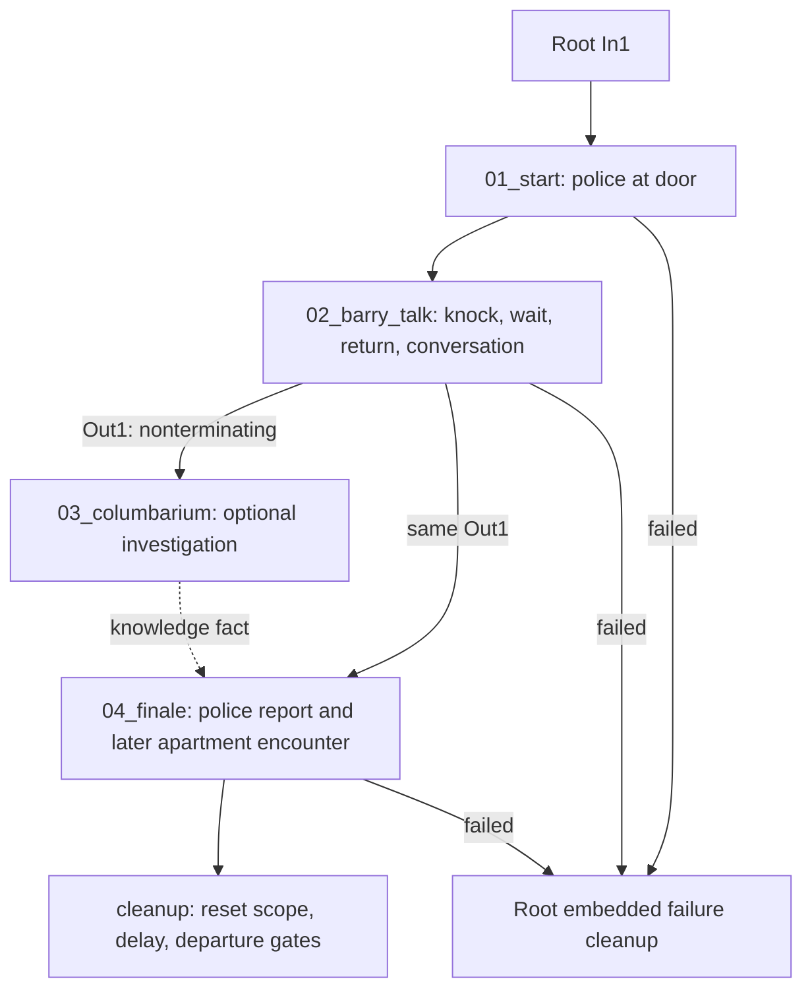

# Happy Together: mq010

**Research result:** this is a strong model for persistent conversational
knowledge, optional work running beside the main route, delayed return, and
outcome staging. Its graph is substantially more complex than its short
objective list suggests.

Evidence: [mq010 index](../../../../reference/quests/deep-dives/mq010.evidence.json).
Depot prefix below: `base\quest\minor_quests\mq010\`.
Read [method and limits](README.md) for snapshot scope and unresolved dependencies.

## Player experience and root structure

Interpretation: encounter the police outside Barry's apartment, try to reach
him, wait and return, learn about Andrew, optionally investigate the niche,
then decide what to tell the police. The later apartment encounter reflects
that conversation state. The journal root is
`quests/minor_quest/mq010_barry`; the resource root is `mq010.questphase`.

**Observed:** root h0 node 3 (`02_barry_talk`) fans the same `Out1` socket to
node 4 (`03_columbarium`) and node 5 (`04_finale`). There is no root edge that
makes the finale wait for the columbarium child. The optional investigation
changes a fact consumed inside the finale scene.

The root exposes test inputs for Barry, the columbarium and the finale. The
columbarium child outputs are not connected back into the root. Barry's
`barry_talk_out` socket is also exposed but unconsumed there. A block extractor
must distinguish a declared interface from an actual parent progression edge.

## Stage 1: ambient encounter becomes a quest

`phases/mq010_01_start.questphase`, h0: 40 nodes, 46 edges, with two embedded
graphs for hostile reaction and environmental device setup.

| Step | Observed evidence |
| --- | --- |
| Prepare offscreen | 0 → 15 waits `IsOutside #mq010_tr_see_barry_spawn`; 2 activates NCPD and Barry `by_door` community phases |
| Activate tracking | POI node 10, active fact 8, crowd-null area 59 and checkpoint 9 prepare the encounter |
| Ambient scene | 9 → scene 105 at entry `mq010_01_cops_start`, alongside AI tier and world setup |
| Ambient-to-player handoff | 105 `mq010_01_cops_end` feeds XOR hubs; scene 23 starts `mq010_01_cops_and_v_start`; its named end changes both officers to `away_door` via 114 |
| Content contention | Distance gates 122/124 use 7 and 13 units to block/unblock token source `mq010_start` at 123/125 |
| Hostility | Embedded h181 watches both officers for combat, death, quickhacks/upload, player hits, and wanted-level-plus-distance conditions; outputs `Attacked` into the failure/retirement route |
| Re-entry/repair | 217 waits `mq010_reactivate_scene`; 238 checks a historical scene condition; 240/241 clear look-at assignment before delayed permanent cut 239 |

The ambient scene has two entries and three exits, including `combat`.
Scene n57 writes `mq010_talk_to_barry_maybe`; the next phase tests that fact
to select the objective version. That is an example of dialogue content
changing quest presentation without immediately committing the final outcome.

## Stage 2: knocking, delay and Barry's conversation

`phases/mq010_02_barry_talk.questphase`, h0: 62 nodes, 70 edges, plus three
embedded graphs. Its `Out1` is explicitly `NonTerminating`.

The normal route activates the talk objective, then arms scene node 22 at
`knock_on_door_in`. Its `knock_on_door_out` first makes the talk objective
inactive and activates `02_wait_for_barry`. Pause 95 waits until that objective
is active; pause 94 then waits **three game hours**. CutControl 23 retires the
knock scene and swaps the wait objective for `03a_try_talking_to_barry`, leading
back to a spatial gate and scene node 9 at `Start 0`.

The time gate therefore does not own the whole return interaction. Objective
state, spatial gates, scene entry selection and cancellation are explicit
neighbors. In parallel, node 97 contains a different one-game-hour condition
combined with camera/menu state to retire the police safely; it must not be
mistaken for the player's three-hour wait.

Scene node 9 exposes several different signals:

| Scene output | Phase consumer | Meaning for a block contract |
| --- | --- | --- |
| `End 0` (scene n2, `NonTerminating`) | Journal 10 succeeds the try-talking objective; CutControl 134 retires a child monitor; 93 unblocks content; 35 deactivates NCPD; output 1 notifies parent | Main progression signal; child remains alive |
| `barry_tier` (n481) | 125/126/127/128 switch between staged gameplay and default tier according to apartment/door trigger state | Side-channel for presentation ownership |
| `door_locked_out` (n491) | Child output 131 `barry_talk_out`, not consumed in the root | Exposed signal does not automatically advance the quest |
| `knock_on_door_out` (n144) | Scene node 22 uses it to enter the timed-return sequence | Separate entry-specific completion |

Hostility/open-door interruption is explicit too: condition 157 combines
trigger, player combat and `DoorControllerPS.IsOpen`; permanent CutControl 77
interrupts scene 9. Nodes 101–103/110/111/115 stop the workspot, move Barry
inside, close/lock the door and restore a sitting workspot as appropriate.
Journal failure and cleanup are authored downstream, not inferred from “scene
stopped”. The scene call also overrides interruption/return scenarios.

## Scene-level dialogue state

`scenes/mq010_02_barry_talk.scene`: 192 nodes, 231 edges, 96 screenplay lines,
19 options. It contains far more than a dialogue tree: attached-to-world knock
prompts, actor-attached choices, workspots, tier outputs, door lifecycle,
keepalive facts, distance/return logic and alternate exits.

Observed choice/state chain:

1. n12 offers responses with an additional build-gated option. n17 provides
   another response choice. Fact writes n23/n42 update `mq010_barry_talk_nice`;
   conditions n30/n46 compare it against 2 and 1 respectively. This is a
   conversational score, separate from Andrew knowledge.
2. n70's third option (`andrew`) reaches section n72, then fact write n81
   `mq010_asked_about_andrew`, then n1082 → n190. The follow-up n190 provides
   further dialogue about Andrew. Merely entering the scene is not equivalent
   to asking this question.
3. Scene n182 writes `mq010_02_01_Talks`, used by the later police scene to
   distinguish whether the substantive Barry conversation happened.

Do not turn every keepalive or animation-related fact into public story state.
For example, `mq010_barry_door_keepalive`, look-at control facts, exit endmarks
and `mq010_barry_v_is_jerk` serve local lifecycle/performance branches. A
reduction needs to review their scope and cancellation, rather than prefixing
and copying every fact into an authoring API.

## Stage 3: optional evidence with its own lifecycle

`phases/mq010_03_columbarium.questphase`: 35 nodes, 42 edges.

| Boundary | Exact evidence |
| --- | --- |
| Eligibility for objective | Condition 17 checks `mq010_asked_about_andrew >= 1`; true activates `04_columbarium` at 3. The false route can still start the scene's `johnny` entry via hub 63 |
| Recognizing the niche | Condition 71 combines distance `<= 3` to `#mq010_andrews_plaque` with on-screen camera focus, angle tolerance 10. It is not a scan-finished event |
| Staging Johnny | 70 observes Johnny trigger and writes spawned fact at 69; scene node 8 supports both `johnny` and `Start 0` entries; content token 48 surrounds the conversation |
| Complete optional conversation | Scene 8 `End 0` → 52 unblocks content → 11 succeeds optional Johnny objective → 9 writes `mq010_know_about_andrew` → reward 14 → checkpoint 13 |
| Leave after observing evidence | 71 → 21 (`IsOutside` Johnny talk trigger) → 23 fails optional Johnny objective → 22 writes the **same knowledge fact** → reward 25 → unblock 51/checkpoint 24 |
| Retire and notify | XOR 26 joins routes and also feeds a separate AND with scene `End 1`; delayed reset 66 clears `mq010_johnny_spawned`; output 61 is `Out2` |
| Cancellation | Pause 73 watches failure of the niche objective, Johnny objective, or quest; emits `Out3`. Other cut/journal conditions handle superseded work |

The strongest reusable discovery here is **evidence acquisition and optional
commentary are separate outcomes**. The player can retain knowledge on the
route where the optional Johnny objective fails. A single `investigate = play
conversation to end` block would misrepresent this quest.

The scene itself has 99 nodes, 122 edges, 30 lines and 6 options. Scene journal
nodes n42/n43 manage the niche/Johnny objectives; camera and trigger checks,
workspot readiness, read-buffer timing and keepalive facts manage Johnny's
appearance and interruption. It uses a dynamic Johnny actor identity rather
than simply borrowing Barry's community contract.

## Stage 4: report, commit and consequence

`phases/mq010_04_finale.questphase`: h0 has 91 nodes and 108 edges, plus embedded
hostility monitoring h477 and objective selection h713.

The decisive state chain crosses resources:

| State | Producer | Consumer |
| --- | --- | --- |
| `mq010_asked_about_andrew` | Barry scene n81 | Columbarium phase 17 controls optional objective availability |
| `mq010_know_about_andrew` | Columbarium phase 9 or 22 | Police scene n4 option 0 has `questCondition >= 1` |
| `mq010_told_police_ab_andrew` | Police scene n12, reached through the evidence-report branch | Finale conditions 208/234/241 and embedded h713 / 2; outcome scene n18 |

Police scene n4 offers an evidence-gated report (option 0), a generic report
(option 1), and a question (option 2). The evidence option follows n67 onward
to n75 → fact writer n12. Knowing the truth therefore **enables a choice**;
the choice still has to be made before the report fact drives the consequence.

The phase first uses scene 15 at `mq010_04_ask_about_barry_start`, then its
named output invokes scene 91 at `mq010_04_police_talk_start`. The terminating
report output feeds condition 241 and the convergence route toward 208.
Condition 208 checks the committed report fact. On its false branch,
378 waits for departure, 380 waits **three game hours**, and 390/391 ensure
the player is outside the finale trigger, retrying after another game hour
when necessary, before applying the changed community/presentation state.
This is a delayed consequence with spatial staging, not a generic quest timer
that begins at initial discovery.

The later scene is named `mq010_05_barry_shot.scene`, but **its filename does
not define one unconditional outcome**: n18 branches on
`mq010_told_police_ab_andrew >= 1`. It also observes policewoman arrival,
speaker distances, readiness and hostile interruptions. Its scene journal
nodes n59/n60 are called through their `Succeeded` mapping on the corresponding
branch. The phase has additional quest-success nodes 489/488 and explicit
failure paths 497/498. Assess journal result from the actual branch/socket,
not from the scene filename or the presence of blood-decoration nodes.

Both narrative consequence and technical failure must remain expressible.
Attacking the officers, breaking a scene's environmental assumptions and
choosing a less helpful response are different signals with different owners.

## Production scene contracts

| Scene | Nodes / edges; lines / options | Interface |
| --- | --- | --- |
| `mq010_01_ncpd_door` | 148 / 178; 46 / 6 | Ambient cops entry, cops-and-V entry; separate ends and `combat` |
| `mq010_02_barry_talk` | 192 / 231; 96 / 19 | `Start 0`, `knock_on_door_in`; `End 0`, tier, locked-door and knock outputs |
| `mq010_03_columbarium` | 99 / 122; 30 / 6 | `Start 0`, `johnny`, debug interrupt entry; two named ends |
| `mq010_04_police_talk` | 184 / 220; 47 / 7 | Ask-about-Barry, report and Mendez-workspot entries; distinct nonterminating/terminating report ends and `combat` |
| `mq010_05_barry_shot` | 56 / 57; 13 / 0 | `Start 0`; `End 0`, `combat`; internal outcome condition |

`phases/mq010_04_barry_combat.questphase` is present in the archive but has no
direct resource reference from the inspected production chain. Do not add an
extra combat stage based on that filename. The production phases embed their
own hostility subgraphs. Historical scene references also occur in migration
checks; those do not replace the current scene calls in the normal route.

## Dependencies, cleanup and repair

| Dependency | Binding that a Ghostline adaptation must provide |
| --- | --- |
| Communities | `mq010_barry.community` entry `barry`, including `by_door`, `dead`, `cyberpsycho` and other authored phases; `mq010_ncpd.community` entries `policeman1`, `policewoman2`, with door, station and finale phases |
| World/interaction | Barry door with `DoorControllerPS`; apartment, exterior, finale and combat trigger NodeRefs; prefab variants including denied areas and blood; crowd-null and vehicle-forbidden areas |
| Motion/staging | Scene markers, Barry's inside-flat spline, sitting/door and officer workspots, AI tier/look-at settings, dynamic Johnny/workspot bindings |
| Story state/UI | Asked/known/reported facts, distinct objective states, journal mappins, reward records, content-token source ownership |
| Performance | Actor, resource and event locstring references retained in evidence; full VO/lipsync/RID/character dependency closure still requires extraction |

Successful phase return enters `mq010_cleanup.questphase`. It sets `mq010_done`
and clears `mq010_active` **before** later cleanup finishes. It resets token,
tier, weather, time, restrictions and prevention state; node 2 then waits
12 game hours. Departure conditions 13/14 feed XOR 15 before community cleanup
and blood-variant reset. The root's failure cleanup h100 performs similar scope
reset/departure work without that 12-hour wait. These are different policies.

Global resets such as `UnblockAll` and `RemoveAllRestrictions` are source
behavior, not a safe generic ownership policy for Ghostline. A reusable block
should track only the state/resources it owns and release them on each exit.

The quest's repair phase is substantial: twelve embedded graphs in
`bugfixing/minor_quests/mq010/mq010_quest_bugfixes.questphase`, plus its outer
graph. Examples include h488 door-lock/inside-apartment recovery, h769
section-state checking and `mq010_reactivate_scene`, h845 officer-workspot and
spawn checks, h954 completed-quest door recovery, and h1104 journal/scene
completion repair. Global activation of these repair phases was not traced.
They expose useful failure cases for fresh designs, not donor logic to copy.

## Ghostline extraction targets

1. Keep `asked`, `known` and `reported` as distinct author-facing state concepts.
2. Build optional evidence as a concurrent child with explicit cancellation;
   optional commentary must be allowed to end without erasing knowledge.
3. Compose the existing time gate with objective, spatial and scene contracts;
   do not hide all of delayed return inside a timer.
4. Expose scene entry, named outcomes, nonterminating notifications and side
   channels. Validate which outputs the parent actually consumes.
5. Separate outcome commit, world staging and eventual cleanup, including
   distinct success/failure policies.

Required installed checks: generic versus Andrew-specific Barry dialogue;
wait and return; already-inside/outside gates; visit niche without objective;
leave after evidence but before optional Johnny completion; know truth but
choose generic report; report the evidence; attack/quickhack either officer;
depart during the finale timer; save/load during parallel work; and confirm
cleanup does not change a committed outcome. None was run in this pilot.
