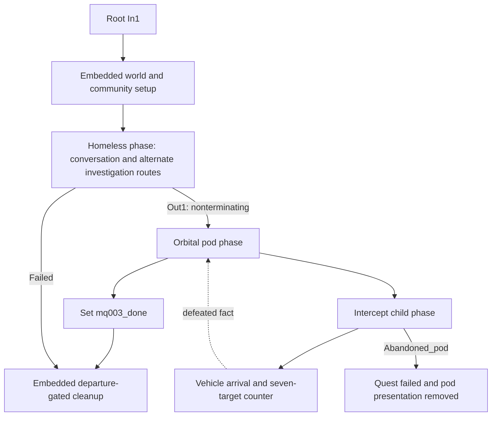

# Space Oddity: mq003

**Research result:** this quest is a useful model for alternate access routes
converging on a world event, followed by a staged encounter and inventory-backed
completion. The reusable unit is a composition of stateful blocks; copying its
combat or scene graph alone would leave essential dependencies behind.

Evidence: [mq003 index](../../../../reference/quests/deep-dives/mq003.evidence.json).
Depot prefix below: `base\quest\minor_quests\mq003\`.
Read [method and limits](README.md) before treating these as implementation rules.

## Player experience and implementation map

Interpretation: negotiate for access to a case, or investigate its previous
owner and use the recovered shard; activate the case, travel to the pod,
deal with the intercept team, acquire the contents and speak with Johnny.

The journal root is `quests/minor_quest/mq003_orbitals`. The root phase is
`mq003_orbitals.questphase`.

The pod phase and intercept phase cooperate through a fact as well as sockets.
The diagram is an abstraction of the stored graph, not a complete execution
simulation. In particular, the homeless child can continue running after Out1.

## Root and child ownership

| Resource / graph / node | Observed responsibility |
| --- | --- |
| Root h0 / 2, embedded h12 | Owns `#mq003_pr_homeless`, activates `#mq003_com_homeless` in `start`, exposes POI, waits for spawn, shows device variant |
| Root h12 / 11 → 3 → 20 → 18 → 19 → 10 | Normal setup waits for `IsOutside #mq003_tr_cin_setup`, activates community, waits `CharacterSpawned`, then toggles `mq003_active` device variant; test fact has a separate shortcut |
| Root h0 / 3 | Calls `phases/mq003_homeless.questphase`; consumes `Out1` and `Failed`; exposes a repair input `CP77-57052_in` |
| Root h0 / 5 | Calls `phases/mq003_orbital_pod.questphase` |
| Root h0 / 12 → 13 | Writes `mq003_done`, then runs embedded cleanup h163 |
| Root h0 / 9, entered by input 10 | Embedded test route with teleport/time setup, not the normal corpse investigation |
| Pod h0 / 21 | Calls `phases/combat/mq003_enemy_intercept.questphase` |

Two traps for a future catalogue: `phases/mq003_corpse.questphase` exists but
is not referenced by the inspected production root/child resource links. The
active homeless phase contains its own corpse investigation. Likewise, the
`mq003_00_chicken_test.scene` and historical `scenes/versions/*` files are not
additional production stages just because their names match the quest.

## Access and investigation: homeless phase

This is the substantial orchestration phase: h0 contains 130 nodes and 156
edges, with two further embedded graphs. It invokes the same scene at several
named entry points rather than playing one monolithic conversation once.

| Boundary | Observed trace | Candidate reduction |
| --- | --- | --- |
| Intro and access negotiation | Scene node 11 invokes `homeless_question`; scene choices n43/n50/n66 cover questioning, purchase, intimidation/background option and refusal | `multi_route_access` with named outcomes and a deferred/re-entry path |
| Hack route | Phase scene node 28 receives `suitcase_hacked_out`; scene n98 → n93 (HARD build check) → n580 → n183 exposes that exit | Skill-gated interaction, separate from possession of a key/shard |
| Clue branch | Pause nodes 113/114 observe `Finished` scans on blood and spot; scene nodes 118/119 invoke clue reactions; both outputs join at AND 120 | `investigate_clue_set`, with reaction completion separate from scan completion |
| Direct corpse discovery | Scene node 121 `corpse_pile_out` → CutControl 122 interrupts obsolete scan waits; condition 159 resolves journal state | Bypass discovery retires superseded clue work |
| Shard acquisition | Inventory condition 146 observes item ID `74384870070`; updates corpse/shard objectives and invokes scene node 158 `shard_taken_in` | `acquire_item` signal, not a proof that a shard was read |
| Shard use | Scene node 133 `suitcase_unlock_out` → 183 writes `mq003_shard_used` → 163 `ForceEnabled` → 167 `ForceON` | Explicit scene-output/device-state adapter |
| Convergence | Hack-side journal route 132 → 149 → 139 → 140 → 141 → 150 and shard-side route 133 → 183 → 163 converge on case enablement | One access commit, retire unused objectives/listeners |
| Launch | Pause 126 waits `mq003_launch_pod >= 1`; succeeds examine objective, marks case inspected, starts activation reaction and warnings/FX | Device completion fact → world-event orchestration |
| Handoff | 128 checkpoint → 177 `Out1`, declared `NonTerminating`; parallel cleanup logic remains in the child | Notification output must not imply phase retirement |

The producer of `mq003_launch_pod` is **not established by the phase/scene
graphs in this pilot**. The phase consumes it, and the activation scene supplies
an interaction, but the case entity/controller's persistent-state graph still
needs inspection before reducing this to an executable device template.

The attack route is also distinct from a dialogue refusal. Scene output
`attacked_homeless_out` starts fallback handling, including an embedded h1118
graph which restores gameplay AI/reaction presets, activates scared community
phases, and waits for distance/camera conditions before deactivation. In that
graph, nodes 13/15/17 test 65-unit distance definitions plus inverted camera
focus; nodes 14/16/18 deactivate the named entries, joining at 21 before writing
`mq003_attacked_homeless_despawned`. The caller waits for that cleanup signal
on the relevant route before emitting `clear`. This is a lifecycle contract,
not a generic “failed conversation means quest failed” rule.

## Production scenes

| Scene | Shape in snapshot | Contract and interpretation |
| --- | --- | --- |
| `mq003_01_homeless.scene` | 176 nodes, 192 edges; 55 screenplay lines, 14 options | Ten named entry points, twelve exits. Hosts dialogue, case interactions, skill/background choices, attack monitoring and return flow |
| `mq003_02_corpse.scene` | 18 nodes, 13 edges; 5 lines, 3 options | Five independent entry/exit pairs: `corpse_pile`, `corpse_examine_in`, `clue_blood_trail`, `clue_spot`, `shard_taken_in` |
| `mq003_03_orbital_pod.scene` | 31 nodes, 26 edges; 18 lines, 2 options | Six entries for soldier beats, clear-enemies prompt, retrieval and reaction; separate `johnny_disappear` output |

These counts describe screenplay records, not a guarantee that every record
plays on one route. The evidence retains line/locstring/event bindings but does
not include a complete spoken subtitle/VO resolution.

The homeless scene provides unusually clear examples of three interaction
surfaces. Dialogue choices attach to an actor; n93's hack and n159/n167's
activate/slot-shard prompts attach to `#mq003_suitcase`. The phase selects the
entry point that makes the appropriate interaction available. A generic
`play_scene(file)` abstraction loses these distinctions.

The corpse scene is a collection of callable reactions. Its entry nodes are
n20/n25/n9/n11/n87; exit nodes n21/n26/n10/n12/n88. The phase invokes the blood
and spot entries independently and explicitly joins their outputs. It does not
derive “all clues inspected” from the existence of the scene resource.

## Pod event, encounter and completion

The pod phase has 58 nodes and 61 edges. On entry, checkpoint 5 branches through
deletion marker 111 to the intercept child, the world setup sequence and the
prevention-area event. These are concurrent parts of one encounter.

| Subsystem | Exact evidence |
| --- | --- |
| Pod presentation | 84/83 remove coverup collision / change decoration variant; 102 shows falling pod; 107 waits within 400 units; 29 plays `fall`; 104 supplies a 17-second alternative into XOR 105; 38/55/57/103/48 perform warning, FX and falling-to-landed swap |
| Vehicle arrival | Intercept 4 activates community; 53 waits for spawn; vehicle nodes assign four soldiers to truck_01 and three to truck_02; 7/9 and 16/17 watch driver/passenger mounts; spline nodes 2/14 move trucks; trigger conditions 79/22 observe truck arrivals |
| Combat staging | Intercept 27/29 set hostile attitude groups; unassignment and `OnUnmount` waits are separate from arrival; 56–59/61–63 issue named soldier spline moves; 65 activates the community `pod` phase |
| Completion counter | Intercept embedded h468: seven named `CharacterKilled` waits 9/13/16/19/22/25/28 each increment the journal counter and feed separate inputs of AND 8 |
| Persistent defeat signal | Child completion reaches intercept 51, writing `mq003_intercept_defeated`; pod 92 waits for equality to 1; pod 93 checks the same fact for the early-arrival prompt |
| Abandonment | Intercept distance condition 70 is `>= 500` from soldier_03; delay 72 is three game hours; CutControl 71 and output 74 `Abandoned_pod` form a separate branch; the parent sends it to quest journal `Failed` at 69 |
| Loot setup | Pod 97 waits within 9 units; 96 injects item TDBID `89925329454` into `#mq003_drop_pod_landed`; 106 uses camera focus to start retrieval scene 53 |
| Loot commit | Pod 116 observes player inventory quantity `>= 1`, after loot setup; 78 succeeds retrieval objective, 79 activates Johnny objective, 75 invokes `retrieve_pod_reaction` |
| Quest success | Scene output `retrieve_pod_reaction_out` → 56 journal `Succeeded` → reward 66 → prevention-area cleanup 127; separate Johnny-disappear and audio completion signals join at AND 77 before phase return |

`CharacterKilled` is the stored condition class; this pilot does not establish
every inherited default for lethal versus unconscious/defeated actors. A
Ghostline reduction must bind that defeat policy explicitly and test it.

The failure branch 69 → 71 → 72 disables landed-pod components before returning
through hub 68. The root subsequently writes `mq003_done` after either return
from the pod phase. Consequently **`done` is a terminal lifecycle marker, not
proof of successful journal outcome**.

The source demonstrates both event feedback and authoritative state checks.
The falling pod, warning messages and retrieval dialogue are presentation;
combat state and item ownership have their own signals. An authored Ghostline
quest should make the relationship between those signals explicit, including
whether early loot acquisition is allowed while the encounter is still active.

## Dependency ownership

| Dependency | Evidence and what Ghostline must supply |
| --- | --- |
| Communities | Extracted `mq003_homeless.community`: `homeless_left`, `homeless_main`, `homeless_right`, with `start/end/scared` phase bindings. `mq003_corpo_squad.community`: named soldiers and vehicles with `start/pod` workspot bindings |
| World layout | `#mq003_pr_homeless`, `#mq003_pr_corpse`, `#sdrc_03_devices`, `#s5_gameplay`, clue entities, case, pod entities and collision triggers. NodeRef use is indexed; definition/sector ownership remains unresolved |
| Routes and staging | Truck and soldier spline NodeRefs, scene markers `#mq003_01_sm_homeless`, `#mq003_02_sm_corpse`, `#mq003_03_sm_orbital_pod`, community workspots and scene resource references |
| Device controller | `ComputerControllerPS` on `#mq003_suitcase`; `ForceEnabled`, `ForceON`, quickhack locking, and external `mq003_launch_pod` producer need a coherent device graph |
| State/UI | Full journal paths, POI, per-stage objectives, numeric reward/item records, warning LocKeys, audio mix signposts, prevention area and content-token sources |
| Speech and performance | Actor bindings, scene animation/workspot references and line locstrings are indexed; subtitle, VO, lipsync and full animation closure are not validated |

Root cleanup h163 removes gameplay restrictions and handles community departure
through separate 200-unit distance conditions, then hides corpse/case/pod and
restores variants. The two sides join before returning. Those distances are
source-specific bindings, not recommended universal despawn radii.

The extracted `bugfixing/minor_quests/mq003` phases include one-shot repair
facts and journal-state checks, alongside sentinel/test-like branches. Their
existence is evidence that migration/repair must be considered, not that every
stored node runs in a normal fresh playthrough. Their global activation was
not traced. Keep them out of a new quest's nominal route.

## Ghostline extraction targets

1. Reduce the scene-entry/exit adapter and multi-route case access first. Bind
   all facts, journal paths, scene markers, device actions and cancellation.
2. Extend clue investigation with an explicit bypass/cancellation contract;
   this differs from the existing all-required clue template.
3. Keep vehicle arrival separate from the named-target combat counter. The
   existing direct `combat_encounter` does not synthesize trucks or splines.
4. Separate set-piece presentation, encounter state, inventory acquisition and
   success/reward commit, then compose them with visible gates.
5. Isolate departure-gated cleanup and its ownership before exporting a donor.

Required installed checks: buy/hack/shard routes; discover corpse before scans;
acquire shard early; refuse and return; attack any homeless actor; leave during
launch; approach before all enemies are defeated; defeat enemies before their
counter branch starts; abandon and return; loot once; save/load during each
handoff; and verify both failure and success cleanup. None was run in this pilot.
