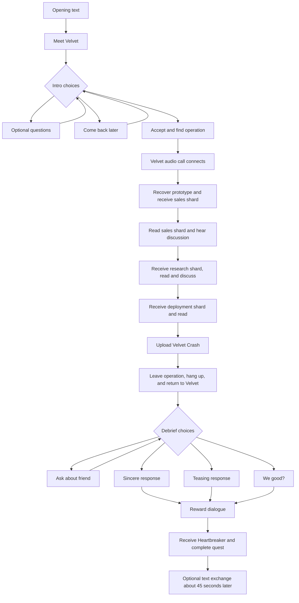

# Love, Actually.exe — current dialogue flow

Dialogue pass 02, including the ten replacement Velvet takes explicitly listening-approved on 2026-10-25. Choice captions appear separately from what V actually says.



## 1. Opening text

**Velvet — message:** Hey, gorgeous. Somebody stole my heart. Technically it's a prototype neural exploit, but that sounds less romantic. Need a favour? ♡

**V — text reply:** Send the location.

*Objective: Meet Velvet in Kabuki.*

## 2. Meeting Velvet

*Her greeting starts when V approaches within roughly 3 m.*

**Velvet:** V. You came. I was expecting a polite refusal and a malware scan.

**V:** Already ran the scan. You're still pending.

**Velvet:** Somebody stole Heartbreaker Protocol. I built it to break emotional-conditioning loops. The Claws turned it into a weapon. Now they're selling it.

### Choice: “What does it actually do?”

**V:** Heartbreaker. That supposed to make me feel better?

**Velvet:** The original interrupts conditioning signals. Gives people a window to say no. Theirs keeps the signal screaming until the nervous system folds.

*Returns to the introductory choices.*

### Choice: “Why keep the stolen code?”

**V:** Why not wipe their server?

**Velvet:** Their build has the only live signing key. Burn it and I can't revoke the copies. Recover first. Patch second. Dramatic explosions a distant third.

*Returns to the introductory choices.*

### Choice: “Flirting or tech support?”

**V:** You always flirt in your bug reports?

**Velvet:** Only the critical ones. Low-priority tickets get a tasteful wink.

*Returns to the introductory choices.*

### Choice: “I'll recover it.”

**V:** I'll get your code. Send me the route.

**Velvet:** Three Claws, two access points. Recover my code and its signing key from the first. Then use the second to shut down the stolen copies. Keep both boxes intact.

**Velvet:** And if you see little black bows in the interface, those are mine. Extremely important diagnostic equipment.

*Accepts the job. Objective switches to finding the Tyger Claw operation. Velvet stays as V leaves.*

### Choice: “I'll come back.”

**V:** Got something else to finish. Keep the location.

**Velvet:** I'll be here. Pretending this is a normal amount of anxiety.

*No job acceptance. Step outside the 2.5 m conversation radius and return. The departure check starts immediately; there is no two-second blind interval. On return, the scene skips the greeting and job introduction and goes straight to the conversation choices once V is in range and out of combat.*

## 3. Arriving at the operation

*The area marker gets V to the operation; the recovery objective then points to the first access point. A native audio-only call from Velvet connects automatically, showing the standard call HUD without video or an answer prompt. It remains connected through recovery, the shard exchanges and upload.*

**Velvet:** That's the operation. Recovery point first. Keep it intact; I need the code, not a smoking case.

**Velvet:** Copy the prototype and its signing key. That key lets us shut down the stolen copies.

## 4. First access point — recover Heartbreaker

*Prompt: Recover Heartbreaker + archived messages. Five-second personal-link transfer; no minigame. The prototype and signing key are recovered, and only the sales shard is handed out at this point.*

**V:** Copy's clean. Got the key.

**Shard received: HEARTBREAKER / wholesale terms**

*Objective: Read this shard. The next step waits until it is marked read.*

```text
BROKER: Baseline drops them for six seconds.
CLIENT: Can it keep them agreeable?
BROKER: We removed the interrupt watchdog. Longer loops available at a premium.
CLIENT: Send a sample.
BROKER: No refunds for affective damage.
```

### After the sales shard is read

**V:** Sales ledger. They're charging extra for a longer feedback loop.

**Velvet:** Of course they are. Turn off the safety and call it a subscription.

## 5. Research archive

*Only granted after the sales discussion finishes.*

**Shard received: VK / conditioning-interrupt research**

*Objective: Read this shard. The next step waits until it is marked read.*

```text
INTENT: interrupt abusive behavioural-conditioning feedback. Never write an emotional preference.
SUCCESS: subject regains the ability to refuse.
ABORT: return all altered values on disconnect.
NOTE: Heartbreaker is a working title. Stop laughing.

UNSENT: You said you couldn't stay angry. I believe you. When you're ready, I have something that might help.
```

### After the research shard is read

**V:** Your archive says conditioning interrupt. Patient keeps emotional autonomy. That wasn't in the sales pitch.

**Velvet:** No. Read the revoke instructions. We'll talk about the rest when you're clear.

## 6. Deployment instructions

*Only granted after the archive discussion finishes.*

**Shard received: Deployment / preserve before patch**

*Objective: Read this shard. The next step waits until it is marked read.*

```text
1. Copy prototype and signing key to isolated storage.
2. Verify checksum.
3. Upload corrected build to distributor.
4. Revoke this stolen batch.
5. Remove conditioning loop; retain bounded combat-system interruption.
Safety watchdog: six seconds. Cosmetic hearts and black bows: intentional.
```

## 7. Second access point — upload Velvet Crash

*After the deployment shard is read, the upload objective and its separate socket marker activate. Velvet explains the fix first; the socket is enabled when that instruction finishes.*

**Velvet:** Good. Upload my fix at the second access point. It'll shut down the stolen copies and give the guards a few seconds of optical trouble.

*Prompt: Upload Velvet Crash. The following exchange starts when V actually plugs in, alongside the five-second transfer bar.*

**V:** Upload says Velvet Crash.

**Velvet:** Fits in the menu. Very professional.

*The naming exchange belongs to the connection attempt. An interrupted link cancels it, and the next attempt can play it again. Success dialogue waits for both the transfer and the naming exchange.*

### After a successful upload

*Waits for Velvet’s remote actor to finish spawning before starting the opening line. V’s reply and Velvet’s exit instruction follow in order.*

**Velvet:** Fix accepted. Stolen copies shut down. Oh, look. Hearts. And the bows survived compilation.

**V:** Their optics didn't.

**Velvet:** The guards' optics will recover. The people they sold this to get their emotions back. Now get clear.

### If either personal-link transfer is interrupted

**Velvet:** Link dropped. Nothing committed. Reconnect when you're ready.

*The interaction can be retried. This same line currently serves recovery and upload.*

## 8. Leave the operation

*Leave the 50 m operation boundary. This accepts V already being outside when the preceding dialogue ends. Guards are released and the objective becomes Return to Velvet. The audio call hangs up before the in-person return stage. There is no extra spoken exchange during this transition.*

## 9. Return to Velvet

**Velvet:** There you are. Code intact. Distribution keys dead. I almost sent a normal thank-you.

**V:** The archive. You built it for someone.

**Velvet:** A friend. Her partner paid for a mood regulator. Called it helping. Every time she got angry, it made being agreeable feel better.

**Velvet:** She knew something was wrong. Just couldn't hold on to the feeling long enough to leave.

**Velvet:** I wanted to give her that feeling back. Not put another one in its place.

### Choice: “You gave her a choice.”

**V:** You gave her a way to choose. That matters.

**Velvet:** She did the leaving. I just broke a lock. Still... thanks for knowing the difference.

*Continues to the shared reward exchange below.*

### Choice: “Hearts and weaponized ribbons?”

**V:** Could've called it Consent Patch. Went with hearts and weaponized ribbons.

**Velvet:** People remember hearts. And the ribbons are black. There are standards.

**V:** Your standards did some good today.

*Continues to the shared reward exchange below.*

### Choice: “Is your friend okay?”

**V:** Your friend okay?

**Velvet:** She's out. We talk when she wants. Sometimes she doesn't. That's sort of the point.

*Returns to the debrief choices. This is optional.*

### Choice: “We good?”

*Continues to the shared reward exchange below.*

### Shared reward exchange

**Velvet:** Your own build. Heartbreaker Protocol. Velvet Crash on the quickhack menu. No conditioning payload. Just a short combat-system interruption and terrible taste.

**V:** Guess I can live with the bows.

**Velvet:** Don't sound so brave. They suit you.

*V receives the Tier 5/Iconic Heartbreaker Protocol item; its quickhack menu name is Velvet Crash. The return objective and quest finish around this ending beat, with a two-tick inventory verification settle. Velvet remains until V leaves the 60 m meeting area. Neither her cleanup nor the final phone reply holds quest completion open.*

## 10. Closing texts — after quest completion

*Starts about 45 seconds after completion. The reply is optional for quest completion.*

**Velvet — message:** Don't get too attached, V. I'm terrible at relationships.

**V — choose either reply:**

- “Could've fooled me.”
- “I'll keep a backup.”

*Both replies receive the same response:*

**Velvet — message:** Actually, I'm pretty good at attachments. It's the detaching that causes problems. ♡

**Velvet — final message:** And V? The bows are non-negotiable. ♡

## Applied review fixes

- The briefing names three guards and two access points. It explains the original purpose and why the key matters even when optional questions are skipped.
- Spoken instructions explain the goal in plain language; the deployment shard retains the technical procedure.
- The success exchange distinguishes temporary guard optics disruption from ending the victims' conditioning loop.
- Retry wording fits both recovery and upload.
- Recovery's post-transfer reply waits for the approach explanation. Upload instructions finish before its connection attempt; the naming exchange starts with the plug-in and cannot overlap the success exchange.
- Remote Velvet uses the vanilla studio marker with its prefab held by the transfer phase; her spawn no longer depends on Kabuki navigation being streamed. The user confirmed the formerly missing success opening now plays. Its spawn-readiness gate is retained.
- The closing line uses the approved replacement take, with matching facial timing.

All 43 unique spoken lines, all dialogue choices, all three shards and both phone threads are included above.
